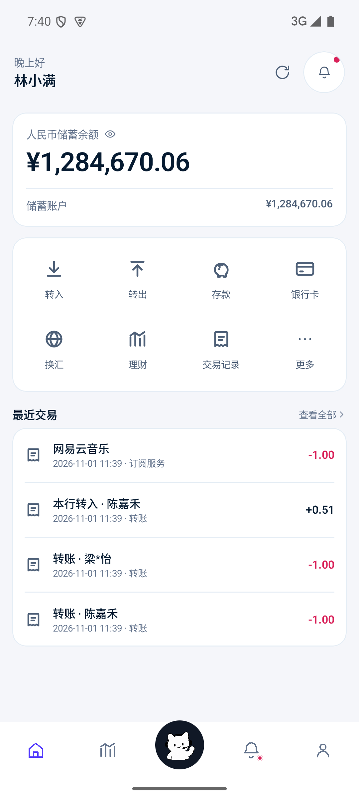
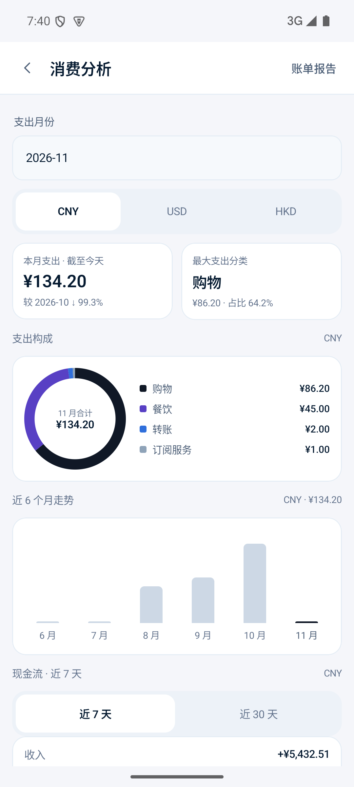
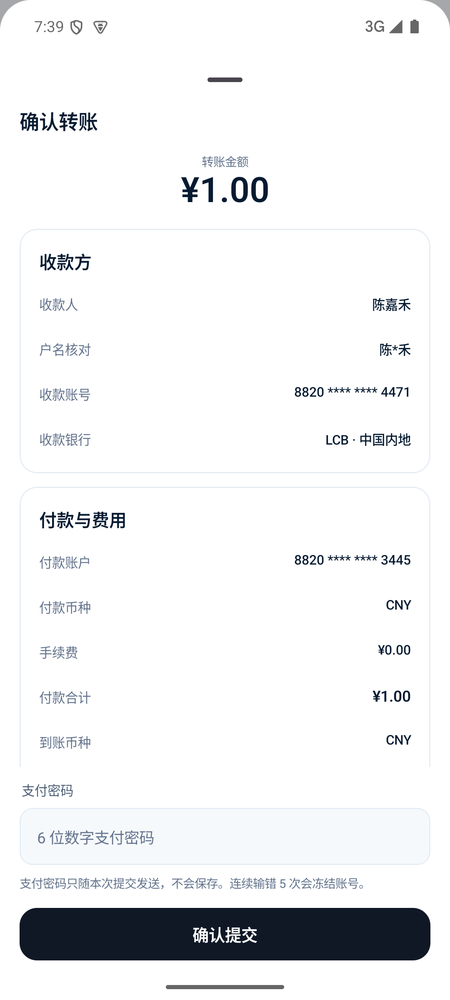
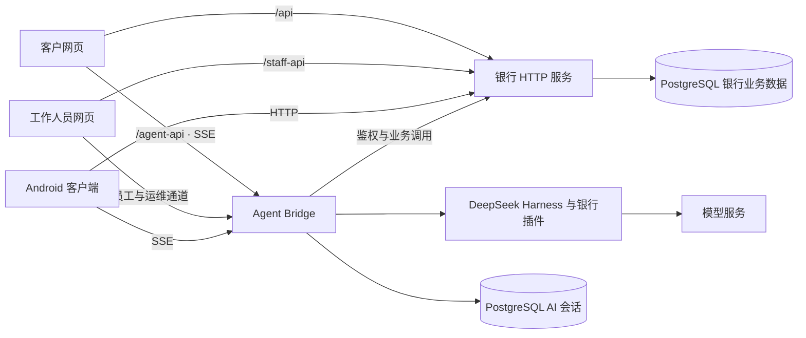

<p align="center">
  
</p>

<h1 align="center">Maneki-Neko · 招财猫银行</h1>

<p align="center">银行业务与 AI Agent 的多端演示及研发平台</p>

<p align="center">
  <a href="server/package.json"><code>Node.js 24+</code></a>
  <a href="app/package.json"><code>React 19</code></a>
  <a href="server/README.md"><code>PostgreSQL 16</code></a>
  <a href="android-app/README.md"><code>Android / Kotlin</code></a>
</p>

<p align="center">
  <a href="#快速开始">快速开始</a> ·
  <a href="#界面预览">界面预览</a> ·
  <a href="#系统架构">系统架构</a> ·
  <a href="#接入-ai-agent">Agent 接入</a> ·
  <a href="#文档导航">开发文档</a>
</p>

Maneki-Neko（招财猫）把账户、转账、银行卡、账单和理财等业务接入对话式助手。用户通过页面或自然语言发起请求，由银行服务校验身份与业务规则；需要授权的操作通过确认卡办理，执行结果以服务端回执为准。仓库包含客户网页、工作人员工作台、Android 客户端、银行 HTTP 服务和多角色 Agent。

> [!NOTE]
> 本项目用于业务演示、开发联调和技术验证。真实合作银行通道尚未接入，`commercialReady=false`。演示余额、模拟交易及虚构产品不代表真实金融服务；当前能力与限制以源码及对应接口文档为准。

## 项目能力

- **账户与支付**：一个资金账户管理 CNY / USD / HKD 余额，支持转账、换汇、FPS、定时转账和 AA 收付款的演示流程。
- **银行卡与安全**：卡片申请、激活、锁卡、挂失、支付开关与限额，以及支付密码和账号冻结处理。
- **账单与规划**：分页流水、CSV 导出、月年报告、月度分类预算、每日平台限额、储蓄目标和自动扣款合约。
- **理财与服务**：风险测评、产品与持仓、申购赎回、保险、信贷、现金管理及工资计划的接口与页面。
- **AI Agent**：知识检索、本人数据查询及工具办理；提供确认卡、流式回复、能力目录，并可选接入图片、语音及 IM。
- **多角色协作**：客户、客服、主管和运维分别鉴权，工作人员通过客户查询、工单、代客办理、审批和审计处理业务。

具体工具范围见 [Agent 能力覆盖](docs/product/agent-coverage.md)。定投、普通储蓄目标、现金管理与工资计划的保存不表示已自动划款；外部银行、商户、短信、人脸与 IM 的接入状态分别受服务端配置限制。

## 界面预览

下图为 Android 1.0.7 UI 重构时在隔离测试环境中留存的**实际实现截图**，用于展示账户、分析与确认流程。更多页面及验证范围见[移动端设计与实现索引](docs/design/mobile-ui/index.md)。

<table>
  <tr>
    <th>账户首页</th>
    <th>消费分析</th>
    <th>转账确认</th>
  </tr>
  <tr>
    <td></td>
    <td></td>
    <td></td>
  </tr>
</table>

## 快速开始

以下命令从**仓库根目录**执行，环境变量示例使用 **PowerShell**。先启动银行后端与统一网页，再按需接入 Agent。

### 1. 准备环境与依赖

| 依赖 | 要求 |
| --- | --- |
| Node.js / npm | Node.js 24 或更高版本 |
| PostgreSQL | 16；准备独立的本地开发库，例如 `maneki_bank_dev` |
| Git | 用于获取源码 |
| 可选工具 | Docker Desktop 用于测试环境；Android 工具链见[安卓客户端](#安卓客户端) |

```powershell
git clone https://github.com/Catgirl540/Maneki-Neko.git
cd Maneki-Neko
npm --prefix server ci
npm --prefix app ci
npm --prefix staff ci
```

各模块独立管理依赖。客户与工作人员网页共用网站入口，开发和构建时都需要安装 `app/` 与 `staff/` 的依赖。

### 2. 初始化并启动银行后端

先创建专用开发库，通过受保护的本地配置向终端 A 注入：

| 变量 | 含义 |
| --- | --- |
| `BANK_DATABASE_URL` | 开发库 PostgreSQL 连接串；结构初始化使用数据库所有者连接 |
| `BANK_DATA_KEY` | 32 字节随机密钥的规范 Base64 编码，与该数据库已有密文匹配 |

仅为**全新空库**生成一次数据密钥：

```powershell
node -e "console.log(require('crypto').randomBytes(32).toString('base64'))"
```

将生成值保存到受保护配置并加载到 `BANK_DATA_KEY`，以后沿用原值。连接串格式如 `postgresql://<用户>:<密码>@127.0.0.1:5432/maneki_bank_dev`；替换占位内容并确保变量已进入当前进程环境，启动命令不会自动加载任意 `.env` 文件。

确认目标是新建的隔离开发库后执行：

```powershell
$env:NODE_ENV = 'development'
$env:BANK_INTEGRATION_MODE = 'sandbox'
$env:BANK_ALLOW_DEMO_SEED = 'true'
node server/bootstrap-postgres.mjs
```

初始化后，将 `BANK_DATABASE_URL` 切换为已授权的应用运行角色连接，再启动服务：

```powershell
$env:BANK_AUTO_MIGRATE = 'false'
node server/index.mjs
```

角色须预先创建；[`grants.sql`](deploy/postgres/grants.sql) 中的数据库名、角色和所有者需按本地环境调整。已有数据的迁移按 [PostgreSQL 运维手册](docs/bank-postgresql-operations.md)执行，保留匹配密钥与历史记录。

后端默认监听 `http://127.0.0.1:8080`。访问 [`/health`](http://127.0.0.1:8080/health) 应返回 `database: "postgresql"`；`commercialReady: false` 表示真实银行通道未就绪。

### 3. 启动统一网页

另开终端 B：

```powershell
$env:VITE_USE_MOCK = 'false'
$env:VITE_PROXY_TARGET = 'http://127.0.0.1:8080'
npm --prefix app run dev
```

| 入口 | 本地地址 |
| --- | --- |
| 官网 | [http://127.0.0.1:5180/](http://127.0.0.1:5180/) |
| 客户登录 | [http://127.0.0.1:5180/login](http://127.0.0.1:5180/login) |
| 工作人员登录 | [http://127.0.0.1:5180/staff/login](http://127.0.0.1:5180/staff/login) |

默认通过 HTTP 访问银行后端；只有显式设置 `VITE_USE_MOCK=true` 才启用浏览器模拟数据。网页主要面向桌面，移动浏览器引导到下载页，移动业务由 Android 客户端承载。

<details>
<summary>隔离 sandbox 的演示账户</summary>

仅适用于上述新建开发库中的演示种子数据：

| 身份 | 账号 | 登录密码 | 支付密码 |
| --- | --- | --- | --- |
| 主客户 | `13800138000` | `123456` | `888888` |
| 另一客户 | `13600136000` | `123456` | `888888` |
| 开发工作人员 | `王小明` / `李主管` / `运维人员` | 未另行配置时为 `123456` | — |

客户短信验证码由演示页面显示。自注册客户自行设置密码；已有数据库中的凭据以实际配置为准。完整步骤与排错见 [README-START.md](README-START.md)。

</details>

<a id="21-接上-agent-与当前银行账户"></a>

## 接入 AI Agent

Agent 独立运行。先安装依赖与 PostgreSQL 会话驱动，再构建插件、知识库、技能及仓库内隔离 profile：

```powershell
npm --prefix framework ci
npm --prefix framework/bridge/pg-runtime ci --omit=dev --ignore-scripts
npm --prefix framework run bootstrap:customer
```

按 [AI 会话运维说明](docs/bank-ai-session-postgresql.md)创建独立运行角色，并由数据库所有者初始化 `ai_sessions` schema。向终端 C 注入以下配置：

| 变量 | 要求 |
| --- | --- |
| `OPENROUTER_API_KEY` | 服务端模型访问凭据 |
| `LUCKYCAT_BANK_URL` | 本地银行地址 `http://127.0.0.1:8080` |
| `LUCKYCAT_SESSION_DATABASE_URL` | 仅授予 AI 会话 schema 所需权限的 PostgreSQL 角色连接 |
| `LUCKYCAT_SESSION_DATA_KEY` | 独立的 32 字节 Base64 会话密钥，与银行数据密钥分开持久保存 |
| `LUCKYCAT_CREDENTIAL_GUARD_PROVIDER` | 使用 OpenRouter 凭据检查时设为 `openrouter`；也可改用下述本机服务 |
| `LUCKYCAT_CREDENTIAL_GUARD_ENDPOINTS` | 本机凭据检查服务的 JSON 端点数组，与 OpenRouter 检查方式二选一 |
| `LUCKYCAT_MODEL` | 可选，选择 profile 已登记的模型 |
| `LUCKYCAT_FALLBACK_MODELS` | 可选，逗号分隔的备用模型列表 |

以下示例选用 OpenRouter 凭据检查：

```powershell
$env:LUCKYCAT_BANK_URL = 'http://127.0.0.1:8080'
$env:LUCKYCAT_CREDENTIAL_GUARD_PROVIDER = 'openrouter'
node framework/bridge/demo-server.mjs
```

客户非空文字输入须先经过凭据检查；未配置或检查服务不可用时，相应请求会被拒绝。OpenRouter 检查会将未被本地规则拦截的消息原文发送给其上游决策模型，并可能产生额外费用；本机模式需要独立准备兼容的环回推理服务。图片本体不在检查范围，语音在转写后才检查。配置与限制见[助手凭据防护](docs/security/助手凭据防护.md)。

客户 Agent 默认端口为 `8788`，Vite 将 `/agent-api` 代理到它。更改端口时同步设置 `LUCKYCAT_DEMO_PORT` 与网页的 `VITE_AGENT_TARGET`。能力入口经 `GET /agent-api/services` 下发，唯一清单为 [`framework/agent-services.json`](framework/agent-services.json)，修改后需重启 Agent。

员工与运维 Agent 见[工作人员助手](docs/api/staff-agent.md)；语音、微信/企业微信及提醒分别按需配置，IM 入口见 [IM 接入说明](docs/api/im-agent.md)。所有模型与服务密钥均只在服务端提供，不写入 `VITE_*`。

## 系统架构



| 模块 | 技术与职责 |
| --- | --- |
| `app/`、`staff/` | React 19、TypeScript 6、Vite 8、Tailwind CSS 4、React Router 7；客户及工作人员网页 |
| `server/` | Node.js 24、HTTP、PostgreSQL 16、`pg`；鉴权、业务规则与持久化 |
| `framework/` | DeepSeek Harness `0.2.1-rc.2`、Cordis、银行插件、知识库与技能 |
| `android-app/` | Kotlin、Jetpack Compose、Android SDK 36；原生移动客户端 |
| `shared/`、`deploy/` | 共用规则，以及 Nginx、systemd、PostgreSQL 部署与维护配置 |

银行业务与 AI 会话分开管理访问角色和加密密钥。客户、员工、运维会话分别使用 `customer`、`staff`、`ops` namespace，每个 namespace 当前只允许一个实例持锁运行。依赖的具体版本以各模块清单和锁文件为准。

## 业务与安全约定

- **一个客户只有一个储蓄资金账户**。多币种余额与多张银行卡归属该账户；卡片不单独存钱，开卡与换汇不另行开户，理财账户表示投资资格。详见[账户模型](docs/product/account-model.md)。
- 金额采用对应币种的整数最小单位（`Cents`），不同币种分别记账、统计。路径与类型分别以 [`contract.ts`](app/src/api/contract.ts) 和 [`types.ts`](app/src/api/types.ts) 为准，端点及错误码见 [API 文档](docs/api/README.md)。
- 需授权的操作通过确认卡发起；未确认、取消或超时均不执行。转账、换汇、投保、借款等敏感操作还需支付密码，模型口头回复不代表已办理。
- 支付密码通过业务确认通道交由银行验证，不应发送到聊天输入框。凭据检查不能保证识别所有变体，其第三方处理边界见上文配置说明。
- Android 的关键资金操作使用服务端原子恢复协议核查未知结果；不支持该协议的后端会被拒绝，网络失败不能直接视为未执行并重复提交。

## 开发与验证

### 日常检查

```powershell
npm --prefix app run check:account-model
node tools/check-contract.mjs
npm --prefix app run lint
npm --prefix app run build
```

网页构建同时生成客户与工作人员页面，产物为 `app/dist/` 与其中的 `staff/`。修改 Agent 后，还需重新构建 profile、校验能力目录与技能，并重启服务：

```powershell
npm --prefix framework run bootstrap:customer
npm --prefix framework run test:services
npm --prefix framework run skills
node --test framework/bridge/credential-guard.test.mjs
```

### PostgreSQL 与 Agent 集成

准备 Docker Desktop 后，可由本地入口创建或复用专用测试环境：

```powershell
node tools/local-test-env.mjs integration
```

该入口仅在 `127.0.0.1:55432` 准备四个可丢弃 PostgreSQL 测试库；也可按[后端验证说明](server/README.md#验证)配置四个测试连接，再运行 `npm --prefix server run check:integration`。测试会重建专用 schema，连接不得指向客户库或开发业务库。

Agent 消息回归还需要已构建的框架及本机凭据决策服务。当前测试入口未内置该决策服务，且会移除外部模型密钥，须单独配置 `LUCKYCAT_CREDENTIAL_GUARD_ENDPOINTS`，并取消已有的 `LUCKYCAT_CREDENTIAL_GUARD_PROVIDER=openrouter` 设置；后者优先于本机端点。仅准备数据库不等于完整集成通过。只读探活可使用 `node server/smoke.mjs`。

## 安卓客户端

准备 JDK 21、Gradle 8.14、Android SDK 36，并配置本机 SDK 路径。工程当前没有 Gradle Wrapper，最低支持 API 26：

```powershell
gradle -p android-app :app:assembleDebug
```

默认连接线上演示服务。本地模拟器联调时显式覆盖银行地址，例如：

```powershell
gradle -p android-app :app:assembleDebug -PbankBaseUrl=http://10.0.2.2:8080
```

`-PbankBaseUrl` 只覆盖银行地址，助手地址仍由 [`AgentApi.kt`](android-app/app/src/main/java/com/moneymeow/bank/AgentApi.kt) 配置，本地助手联调需同步调整。调试包输出为 `android-app/app/build/outputs/apk/debug/app-debug.apk`。`dev` 变体提供独立包名与演示自动登录，仅供联调；正式发布须使用独立签名的 release APK。构建、原子恢复和仪器测试见[安卓维护说明](android-app/README.md)，端间差异见[安卓与网页对齐清单](docs/product/android-web-parity.md)。根目录 `android/` 仅保留迁移提示，不用于构建。

## 部署

使用 Nginx 提供静态页面并反向代理银行 API、Agent HTTP 与 SSE，Node 服务由 systemd 管理。生产模式要求 `BANK_INTEGRATION_MODE=live`；`NODE_ENV=production` 与 `sandbox` 组合会拒绝启动，切换为 `live` 也不会启用尚未接入的银行能力。

发布须同步部署代码、插件、知识库、技能和 profile；只替换静态网页不会更新 Agent。备份与恢复需保留数据库、匹配密钥、Harness 日志和附件。具体步骤及演示环境的数据源边界见[单机部署说明](deploy/single-host/README.md)、[统一银行环境](docs/unified-bank-environment.md)和 [PostgreSQL 运维手册](docs/bank-postgresql-operations.md)。

## 仓库结构

```text
Maneki-Neko/
├── app/            客户网页与统一网站入口
├── staff/          客服、主管、运维网页
├── android-app/    当前 Kotlin / Compose 安卓工程
├── server/         银行 HTTP 服务与业务测试
├── framework/      Agent Bridge、银行插件、知识库与技能
├── shared/         共用业务规则
├── docs/           接口、产品、设计、验证与运维文档
├── deploy/         部署配置与维护工具
├── tools/          契约检查、联调、截图与打包工具
├── design/         设计评审与历史交接资料
├── deliverables/   演示、报告与答辩交付材料
└── archive/        历史实现，仅供回溯
```

当前客户端位置以 [CLIENTS.md](CLIENTS.md) 为准。开发前阅读 [AGENTS.md](AGENTS.md)，默认排除 `archive/`，不操作 `.arch/`。

## 文档导航

| 需求 | 文档 |
| --- | --- |
| 本地启动与排错 | [README-START.md](README-START.md) |
| 客户网页 / 工作人员端 | [app/README.md](app/README.md) · [staff/README.md](staff/README.md) |
| 后端配置与测试 | [server/README.md](server/README.md) |
| HTTP 接口与账户规则 | [API 文档](docs/api/README.md) · [账户模型](docs/product/account-model.md) |
| Agent 工具与技能 | [能力覆盖](docs/product/agent-coverage.md) · [技能维护](framework/design/SMART-SERVICE-SKILLS.md) |
| 会话与凭据检查 | [AI 会话运维](docs/bank-ai-session-postgresql.md) · [助手凭据防护](docs/security/助手凭据防护.md) |
| Android 接入与端间差异 | [安卓维护](android-app/README.md) · [对齐清单](docs/product/android-web-parity.md) |
| 更多设计、验证和发布记录 | [docs/README.md](docs/README.md) |

## 参与贡献

欢迎通过 [Issues](https://github.com/Catgirl540/Maneki-Neko/issues) 报告问题，通过 [Pull requests](https://github.com/Catgirl540/Maneki-Neko/pulls) 提交改进。请说明复现步骤、相关模块、运行版本、预期与实际结果，日志中去除凭据与个人数据。

变更说明应包含业务影响和实际执行的验证。修改接口或业务规则时，同步维护契约、文档及对应断言；不要将测试用例存在视为测试已通过。

## 许可

仓库当前未提供 `LICENSE` 文件，使用、修改与分发权限需与维护者确认。第三方依赖、字体、银行及卡组织标识的权利归各自权利人所有。
