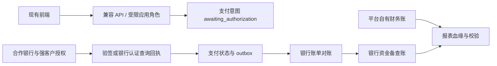

# PostgreSQL 银行合作平台数据库设计

适用模式：中国内地人民币零售，由合作持牌银行保管客户资金并执行支付。当前尚无合作银行；生产适配器注册表为空，真实支付、账户余额及外部回执通道关闭。系统不将数据库建设视作银行经营资格或监管接口验收。

## 1. 数据域与资金来源

| Schema | 核心对象 | 责任 |
| --- | --- | --- |
| `public` | 客户主档、加密域状态、兼容历史账户和流水、凭证、会话、工单审批、审计 | 保全旧数据并维持现有 API；旧账户标记 `legacy_demo` |
| `banking` | providers、release_gates、account_links、consents、payment_intents、receipts、outbox、statement_*、reconciliation_* | 记录银行账户及银行端授权、执行结果和对账证据 |
| `accounting` | charts、subjects、books、accounts、business_days、journals、entries、daily_balances | 独立账簿、分币种借贷平衡、凭证不变及日结 |
| `regulatory` | report_definitions、report_runs、report_lineage、validation_results | 报表模板、审批版本、来源和校验；没有自动监管报送 |

客户资金不记为平台自有资产或存款负债。真实账户余额必须带银行确认时间与单调序列；旧回执不能覆盖较新的余额。支付成功回执也不擅自推算银行新余额，余额由专门的银行余额快照更新。

## 2. PostgreSQL 事务与兼容存储

资金使用整数最小货币单位；数据库使用 BIGINT、约束和外键，API 超出 JavaScript 安全整数范围时拒绝精度丢失。币种比较、账户归属和金额在数据库与服务层共同校验。

旧客户端业务通过内存档案投影保持契约。每次兼容业务先取得 PostgreSQL 事务级 advisory lock、重新读取已提交状态并清除业务缓存；账户变化、双边流水、审批、幂等响应、审计和借贷凭证在同一事务提交。失败时整体回滚。原生银行连接仓储使用独立连接和事务，不加入其他请求的兼容投影事务。HTTP 兼容入口仍有限长队列，当前发布不声称多副本吞吐或高可用。

客户认证令牌仅保存摘要，持久化到 PostgreSQL，可跨后端重启验证；员工令牌保留进程内存，重启后需重新登录。验证码、身份票据、幂等键及客服写入通过行锁或事务 advisory lock 防止重复消费。

## 3. 银行准入、授权和支付状态

providers 必须具有许可机构标识、合同证据摘要、双人审批；release_gates 存银行合同、生产 API、强授权、验签、对账、安全、隐私、灾备和验收证据及失效时间。数据库记录通过还必须匹配实际注册的可信适配器；不能只改一行配置就生成银行连接。生产环境拒绝测试适配器和 test_fixture 回执。

支付意图主键为 UUID，按客户与幂等键唯一，请求哈希一致才可复用；客户归属、账户及授权采用组合外键。收款资料、银行账户引用、授权原文和回执正文加密保存。新增意图只有 `awaiting_authorization` 状态，不扣本地余额，不产生银行执行结果。

银行认证回执才能推进授权或终态，回执必须匹配银行支付参考号、付款账户引用、金额与币种。服务端只信任适配器验签或经认证银行查询的结果，不接受客户端 `verified=true`。事件标识与正文摘要防止篡改重放；乱序结算回执保留，待对应授权确认后再处理。终态不能被后来的冲突回执覆盖。

outbox 租约超时转 `unknown`，禁止自动重发。银行未确定，目前没有向真实银行发送付款的派发器或强授权跳转实现；这些必须按具体银行协议交付并验收。前端的旧模拟转账在 live 模式不能绕过新流程。

## 4. 科目、复式记账与日结

`charts` 的版本、适用目的、生效日期和审批状态决定账簿可用性；科目带父级、六类分类、借贷方向和是否允许记账。科目账户固定关联账簿、科目、币种及可选客户、银行账户。凭证只能从草稿建起，过账时验证已审批科目、有效营业日和每币种借贷平衡；已过账凭证及分录禁止改删，修正应以新的反向凭证及业务引用完成。

提供平台财务模板 `CN-PLATFORM-DRAFT-1`，覆盖资产、负债、权益、收入、费用和表外分类，以及独立的 `BANK-MEMO-1` 银行资金备查科目。模板仍需实际主体的会计政策确认，不能宣称是适用于所有银行的“全量监管认可科目”。科目可按机构增加版本与明细，历史凭证保留当时科目版本。

`accounting.close_business_day(book,date)` 核验草稿、锁定营业日、生成累计借贷余额并关闭营业日；详见数据库触发器及真实 PostgreSQL 会计测试。当前没有自动计息、贷款摊销、减值计算、银行清算网络或监管报送适配器。

财政部说明会计准则应用指南及后续解释持续形成具体适用口径，科目应由业务和财务确认：[企业会计准则应用指南资料说明](https://www.mof.gov.cn/bd/mhwzzxly/hjs/202301/t20230104_3861971.htm)。

## 5. 迁移与权限

`migrate-sqlite-to-postgres.mjs` 仅在维护时读取独立 SQLite 快照；目标必须为空，沿用字段密钥。脚本逐表保留客户、余额、流水 ID、历史凭证、审批和审计，核对行数与余额，事务失败整体撤销。支持的辅助默认值、CHECK、索引和外键保留；遇到不支持的表达式或自定义触发器拒绝迁移。源库不会被修改，运行入口不打开 SQLite。

结构由 `bootstrap-postgres.mjs` 以所有者部署；`BANK_AUTO_MIGRATE=false` 阻止应用运行时 DDL。`deploy/postgres/grants.sql` 分离所有者、HTTP 应用与银行 worker；应用不能新增已批准银行、签名回执、银行确认余额或调整科目政策。字段使用 AES-256-GCM 加密，密码使用独立盐 scrypt。数据库备份、字段密钥和银行私钥分别保管。

当前单机环境仍需具体银行接入、HTTPS、外部监控、异地备份与恢复验收后，才能按约定业务范围开放真实服务。实际部署结果与命令见 [运维手册](bank-postgresql-operations.md)。
