# 安卓端全站 UI 巡检 · 2026-11-01

- 设备：`emulator-5554`，1080×2400，登录账号 林小满 / 13800138000，后端 `https://bank.waveflow.men`
- 方法：逐页进入后用 `uiautomator dump` 定位 + 截图，共 41 张，覆盖 5 个主 Tab、更多服务全部入口、储蓄与计划 4 个 Tab、理财 4 个 Tab、转账全流程与确认弹层
- 截图存放：`docs/product/assets/android-ui-audit/`（41 张，按访问顺序编号）
- 一页浏览全部截图：[index.html](assets/android-ui-audit/index.html)（网格缩略图，点开看原图）
- 结论：功能已对齐网页端，但**布局精致度参差**——有约一半二级页面仍是"裸表单 + 大量留白"，与首页/银行卡/会员的卡片风格不在一个水平线上

---

## 一、丑榜（1 = 最该先改）

| # | 页面 | 主要问题 | 严重度 |
|---|---|---|---|
| 1 | 储蓄与计划 · 现金管理 | 整页只有 1 行文字 + 1 个空输入框 + 2 个按钮，下方约 65% 完全空白；`停用规则` 是窄描边按钮挂在通栏黑按钮下面，层级混乱 | 严重 |
| 2 | 储蓄与计划 · 生日 | 4 个无提示空胶囊（联系人/关系/生日/金额）+ 币种分段器 + 1 个黑按钮，下方 55% 空白；日期框只有 `YYYY-MM-DD` 占位 | 严重 |
| 3 | 储蓄与计划 · 定投 | 4 个基金是**纯文本行**，没有卡片、没有单选态、没有分隔，看不出能点、也看不出选了哪个；频次分段器选中块与容器圆角不对齐；`每期金额` 空胶囊无占位；`暂停/取消` 是裸文字链 | 严重 |
| 4 | 支出预算 | 整页裸表单：原生方框复选框（8 行、每行 150px 无分隔）、无卡片、无分组；顶部灰色说明紧贴导航栏且右侧被裁；首屏看不到提交按钮；`暂无预算` 是一行灰字 | 严重 |
| 5 | IM 连接 | 三个按钮三种宽度（`微信日程提醒` 窄描边、`刷新连接状态` 窄描边、`生成微信连接二维码` 通栏黑），下方 75% 空白，没有任何绑定说明/二维码占位 | 严重 |
| 6 | 通知设置 | 一张卡片里两行**居中**灰字（"服务端暂未提供…"），下方 85% 空白；居中对齐与本页其它左对齐行不一致 | 严重 |
| 7 | 语言与地区 | 同上：一张卡片两行居中灰字 + 一张三行信息卡，70% 空白；语言项没有可选项，只有一句"英文尚未提供" | 严重 |
| 8 | 更多服务 | 图标重复/错用：`账单与交易`/`账单报告`/`理财记录` 同一枚票据图标；`消费分析`/`产品市场`/`我的持仓` 同一枚 M；`会员中心` 用的是**勾**；`银行卡管理`/`模拟消费`/`借款与分期` 同一枚卡。且全部裸图标铺在页面底色上，无卡片分组 | 严重 |
| 9 | 消费分析 | 近 6 个月柱图**柱与标签对不上**：第 5 根柱（10 月）没有标签，最右 `11 月` 只剩一条横线；环形图有约 1/6 的缺口（购物占 99.5% 却画不满）；`现金流·近7天` 的收支与顶部"本月支出 ¥215.62"口径冲突 | 严重 |
| 10 | 转出 · 填写金额 | 币种分段器的选中底色是**方形内嵌块**，压在容器圆角里（明显样式 bug）；`收款金额` 可编辑却只是个镜像值；金额未填时整张报价卡 5 行全是 `—`；付款币种与金额框之间有一大片空 | 严重 |
| 11 | 转出 · 确认转账弹层 | 11 行信息平铺无分组，金额 `¥1.00` 淹没在行里；`收款账号` 已脱敏但 `收款标识` 又把完整卡号明文列了一遍；首屏看不到确认按钮，必须滚动 | 严重 |
| 12 | 账单报告 | `月度明细` 行里"收 ¥0.00 · 支 ¥215.62"太长，`5 笔` 被挤到第二行右对齐，断行错位；支出分类的进度条是 1–2px 细线（转账那条几乎看不见），没有百分比 | 中 |
| 13 | 个人资料 | `身份证号`/`开户日期`/`联系地址` 三行都是 `—` 占位；唯一的通栏黑按钮是最危险的 `修改手机号`；手机号在此页明文、在"我的"页却是 `138 **** 8000` | 中 |
| 14 | 模拟消费 | 裸表单：卡选择是一行带勾的粗体、商户是一行粗体、两个空胶囊、一个按钮，再来一个孤零零的 `刷新银行卡` 小按钮，下方 55% 空白 | 中 |
| 15 | 定时转账与 AA | **`收款银行` 标签重复出现了两次**（真实 bug）；表单依旧裸铺；`定时指令` 只有"暂无记录"四个灰字 | 中 |
| 16 | 交易记录 | 顶部筛选条横向溢出：`订…` 被裁断，下载/筛选两个圆形按钮直接浮在胶囊上，没有渐隐遮罩，看起来像压在一起 | 中 |
| 17 | 银行卡 | 分页圆点压在卡片下沿、蓝底上几乎看不见；`正式挂失` 与 `换卡`/`寄送信息` 同级同色（应降权或标红）；`我的卡片 / 3 张` 标签悬在卡片正上方，间距过挤；`VALID THRU ••/••`、`CVV •••` 是未完成的占位 | 中 |
| 18 | 交易详情 | 支出金额是黑色（列表里同笔是红色），且没有"交易成功"状态标识；`对方账户`/`对方银行` 两行全是 `—`；`资金账户` 22 位、`参考编号` 20 位都不分组；顶部两个圆形图标按钮线条粗细不一致 | 中 |
| 19 | 理财 · 产品 | 每张产品卡右下角都挂一条红色 `超出风险承受能力`，四张连排像四个报错；`R1–R3` 是灰蓝胶囊、`R4` 却是粉红胶囊；筛选条 `商品` 在右边缘被裁 | 中 |
| 20 | 我的 | 最后一张卡（`关于招财猫银行`）被底部导航压住，缺底部安全间距；`会员等级` 用 M 图标，语义不对 | 中 |
| 21 | 理财 · 持仓 / 记录 | 空状态是左上角一行灰字 `暂无持仓` / 一张卡片里一行居中灰字，90% 空白，没有图标也没有"去产品市场"的引导 | 中 |

### 次一级（同一套问题，改法相同）

| 页面 | 问题 |
|---|---|
| 存款 | 余额行 + 3 个图标块 + 一张"暂无可用的定期存款产品"居中灰字卡，70% 空白 |
| 换汇 | 卖出币种只有 CNY 却做成黑色胶囊选择器；可用余额是裸灰字；卡片内一句说明 + 按钮下一句说明，两句重复 |
| 工资与备用金 | `修改计划` 是卡内左下角窄描边按钮；备用金卡片里"年化 5.80%…"整段灰字 + 一个看起来禁用的开关；页尾再一段居中灰字 |
| 自动扣款 | 页尾灰色免责声明被底部导航裁断；`腾讯视频` 写"每年 5 月"但"下次 2026-11-24"；每张卡都重复一行"自动扣款/到期按合约扣款" |
| 邀请与奖励 | `复制邀请码`、`复制邀请链接` 两个窄描边按钮 + 中间夹一段长 URL + 下面又通栏 `分享邀请链接`，动作重复且节奏乱；推荐进度行右侧状态与金额上下错位 |
| 保险保障 | 顶部 `总保额 ¥10,000.00`，下面唯一保单 `保额 ¥60,000.00`，同一屏两个数字互相矛盾 |
| 理财 · 总览 | `去测评` 提示行前面是一个**勾**（应为警示/盾）；`开立理财账户` 是窄描边按钮，与页面唯一主线动作不匹配 |
| 安全中心 | 右上 `刷新` 是文字（其它页都是圆形图标）；`修改支付密码` 用勾图标 |
| 关于 | 入口写"关于招财猫银行"、页面标题写"关于"；`服务条款与隐私政策尚未提供正式文本。` 作为一条设置行出现，像没做完 |
| 我的收款账户（弹层） | 只有账号/银行两行 + 一句说明，没有复制按钮，22 位账号不分组 |

---

## 二、跨页共性问题（改一处收益最大）

1. **"裸表单"模式**
   `内地转账`、`换汇`、`定时转账与 AA`、`模拟消费`、`支出预算`、`生日`、`现金管理`、`定投` 都是同一套：灰色小标签 → 白色胶囊 → 通栏黑按钮，直接铺在 `#F5F7FF` 页面上，没有任何卡片容器，页面下半截 50–70% 是空白。
   与首页/银行卡/会员的"白卡 + 分隔线"风格完全是两套语言。
   **建议**：统一成"一张白卡包住整组字段（卡内用 hairline 分隔）+ 卡外一个主按钮"，并在卡片顶部加一行标题（如"收款信息"、"规则设置"）。

2. **分段器（Segmented）选中态是方形内嵌块**
   出现在理财 4 Tab、储蓄 4 Tab、账单报告、消费分析、转账金额币种、定投频次。选中块的直角压在容器圆角里，视觉上像渲染错误。
   **建议**：选中底色改为与容器同圆角的胶囊（或直接改成胶囊 Chip 行）。

3. **灰字免责声明当填充物**
   `时区/预算/备用金/自动扣款/IM/现金管理` 都把 1–2 行居中小灰字塞进卡片。用户已多次表示不要这种"解释性灰字"。
   **建议**：能删则删，必须保留的降到页脚单行、左对齐、12sp。

4. **空状态只有一个词**
   `暂无持仓`、`暂无记录`、`暂无预算`、`暂无可用的定期存款产品`。
   **建议**：统一空状态组件（图标 + 一句说明 + 一个主行动）。

5. **数字与账号未格式化**
   22 位资金账号、20 位参考编号、收款账号（`8820000000112233445`）全部连续输出。
   **建议**：4 位一组分隔；账号/卡号脱敏规则全站一致（确认弹层已经出现"脱敏 + 明文"并存）。

6. **底部安全间距缺失**
   `我的`、`自动扣款` 的最后一行被底部导航覆盖。
   **建议**：所有可滚动页补 `contentPadding.bottom = 96.dp`。

---

## 三、可直接修的确定性 bug

| 位置 | 现象 |
|---|---|
| 储蓄与计划 · 定时转账（更多服务 → 定时转账与 AA） | `收款银行` 标签渲染两次 |
| 保险保障 | 顶部总保额 `¥10,000.00` 与保单 `保额 ¥60,000.00` 不一致 |
| 消费分析 · 近 6 个月走势 | 第 5 根柱无标签、`11 月` 无柱，柱与标签错位 |
| 消费分析 · 支出构成 | 环形图缺口与 99.5% 占比不符 |
| 转出 · 填写金额 | 币种分段器选中块为方形、与容器圆角冲突 |
| 转出 · 确认转账 | `收款标识` 明文完整卡号，与上方脱敏的 `收款账号` 冲突 |
| 账单报告 | `5 笔` 断行错位；分类进度条高度仅为 1–2px |
| 更多服务 / 安全中心 | `会员中心`、`修改支付密码` 使用勾图标 |
| 银行卡 | `VALID THRU`/`CVV` 显示 `••/••`、`•••` 占位 |
| 自动扣款 | `腾讯视频` 周期"每年 5 月"与"下次 2026-11-24"矛盾 |

---

## 四、建议的下一轮顺序

1. **第一梯队（4 个页面，一次性重做）**：现金管理 / 生日 / 定投 / 支出预算 —— 全部套用"卡片分组 + 空状态 + 主按钮"模板
2. **第二梯队**：IM 连接、通知设置、语言与地区、更多服务（图标 + 分组）
3. **第三梯队**：两处图表（消费分析、账单报告）+ 转账金额页币种分段器
4. **顺手修**：第三节 10 个确定性 bug

> 本轮只做巡检，未改动任何代码。

---

## 五、全部截图（41 张，按访问顺序）

目录：`docs/product/assets/android-ui-audit/`。状态列：🔴 进丑榜 / 🟡 次一级 / 🟢 达标。

| # | 文件 | 页面（入口） | 状态 |
|---|---|---|---|
| 01 | [01-home.png](assets/android-ui-audit/01-home.png) | 首页 | 🟢 |
| 02 | [02-wealth-overview.png](assets/android-ui-audit/02-wealth-overview.png) | 理财 · 总览 | 🟡 |
| 03 | [03-notify.png](assets/android-ui-audit/03-notify.png) | 通知 | 🟡 |
| 04 | [04-me.png](assets/android-ui-audit/04-me.png) | 我的 | 🟡 |
| 05 | [05-cards.png](assets/android-ui-audit/05-cards.png) | 银行卡 | 🟡 |
| 06 | [06-transactions.png](assets/android-ui-audit/06-transactions.png) | 交易记录 | 🟡 |
| 07 | [07-tx-detail.png](assets/android-ui-audit/07-tx-detail.png) | 交易详情 | 🟡 |
| 08 | [08-receive-account-sheet.png](assets/android-ui-audit/08-receive-account-sheet.png) | 转入 · 我的收款账户弹层 | 🟡 |
| 09 | [09-transfer-select.png](assets/android-ui-audit/09-transfer-select.png) | 转出 · 方式与收款人 | 🟡 |
| 10 | [10-transfer-form.png](assets/android-ui-audit/10-transfer-form.png) | 内地转账 · 填账号 | 🟡 |
| 11 | [11-transfer-amount-empty.png](assets/android-ui-audit/11-transfer-amount-empty.png) | 填写金额（空态） | 🔴 |
| 12 | [12-deposit.png](assets/android-ui-audit/12-deposit.png) | 存款 | 🟡 |
| 13 | [13-fx.png](assets/android-ui-audit/13-fx.png) | 换汇 | 🟡 |
| 14 | [14-more.png](assets/android-ui-audit/14-more.png) | 更多服务 | 🔴 |
| 15 | [15-analysis.png](assets/android-ui-audit/15-analysis.png) | 消费分析 | 🔴 |
| 16 | [16-billing-report.png](assets/android-ui-audit/16-billing-report.png) | 账单报告 | 🔴 |
| 17 | [17-budget.png](assets/android-ui-audit/17-budget.png) | 支出预算 | 🔴 |
| 18 | [18-auto-debit.png](assets/android-ui-audit/18-auto-debit.png) | 自动扣款 | 🟡 |
| 19 | [19-payroll.png](assets/android-ui-audit/19-payroll.png) | 工资与备用金 | 🟡 |
| 20 | [20-loans.png](assets/android-ui-audit/20-loans.png) | 借款与分期 | 🟢 |
| 21 | [21-savings-goals.png](assets/android-ui-audit/21-savings-goals.png) | 储蓄与计划 · 存钱目标 | 🟢 |
| 22 | [22-savings-dca.png](assets/android-ui-audit/22-savings-dca.png) | 储蓄与计划 · 定投 | 🔴 |
| 23 | [23-savings-cash.png](assets/android-ui-audit/23-savings-cash.png) | 储蓄与计划 · 现金管理 | 🔴 |
| 24 | [24-savings-birthday.png](assets/android-ui-audit/24-savings-birthday.png) | 储蓄与计划 · 生日 | 🔴 |
| 25 | [25-membership.png](assets/android-ui-audit/25-membership.png) | 会员等级 | 🟢 |
| 26 | [26-insurance.png](assets/android-ui-audit/26-insurance.png) | 保险保障 | 🟡 |
| 27 | [27-security.png](assets/android-ui-audit/27-security.png) | 安全中心 | 🟡 |
| 28 | [28-invite.png](assets/android-ui-audit/28-invite.png) | 邀请与奖励 | 🟡 |
| 29 | [29-aa-scheduled.png](assets/android-ui-audit/29-aa-scheduled.png) | 定时转账与 AA | 🔴 |
| 30 | [30-mock-spend.png](assets/android-ui-audit/30-mock-spend.png) | 模拟消费 | 🔴 |
| 31 | [31-profile.png](assets/android-ui-audit/31-profile.png) | 个人资料 | 🔴 |
| 32 | [32-im.png](assets/android-ui-audit/32-im.png) | IM 连接 | 🔴 |
| 33 | [33-notify-settings.png](assets/android-ui-audit/33-notify-settings.png) | 通知设置 | 🔴 |
| 34 | [34-language.png](assets/android-ui-audit/34-language.png) | 语言与地区 | 🔴 |
| 35 | [35-support.png](assets/android-ui-audit/35-support.png) | 帮助与客服 | 🟢 |
| 36 | [36-wealth-products.png](assets/android-ui-audit/36-wealth-products.png) | 理财 · 产品 | 🟡 |
| 37 | [37-wealth-holdings.png](assets/android-ui-audit/37-wealth-holdings.png) | 理财 · 持仓（空态） | 🟡 |
| 38 | [38-wealth-records.png](assets/android-ui-audit/38-wealth-records.png) | 理财 · 记录（空态） | 🟡 |
| 39 | [39-about.png](assets/android-ui-audit/39-about.png) | 关于 | 🟡 |
| 40 | [40-transfer-amount-filled.png](assets/android-ui-audit/40-transfer-amount-filled.png) | 填写金额（已填 ¥1） | 🔴 |
| 41 | [41-transfer-confirm.png](assets/android-ui-audit/41-transfer-confirm.png) | 确认转账弹层 | 🔴 |

---

## 六、丑榜前 12 截图

**1. 现金管理** — 一行字 + 一个输入框 + 两个按钮，65% 空白

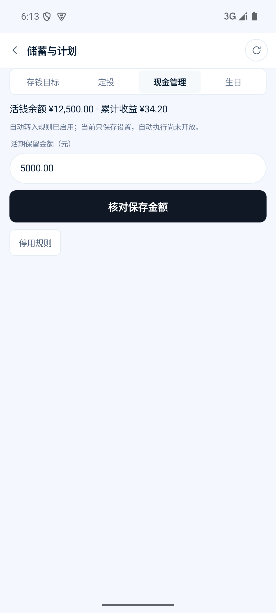

**2. 生日** — 4 个无提示空胶囊，55% 空白

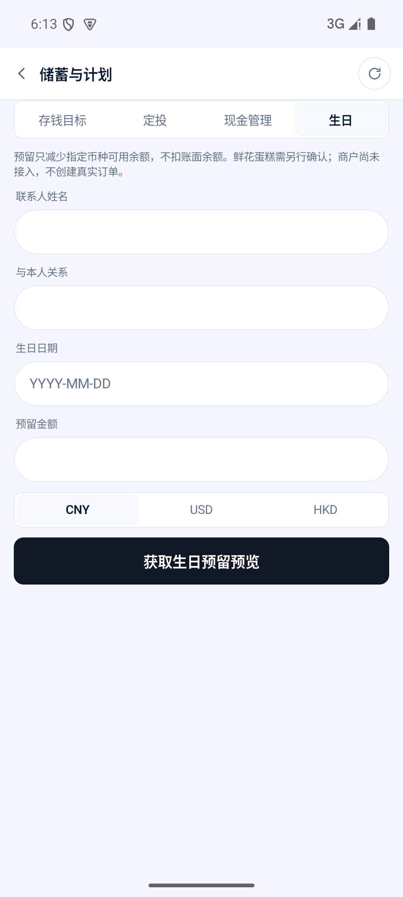

**3. 定投** — 基金是纯文本行，无卡片、无选中态

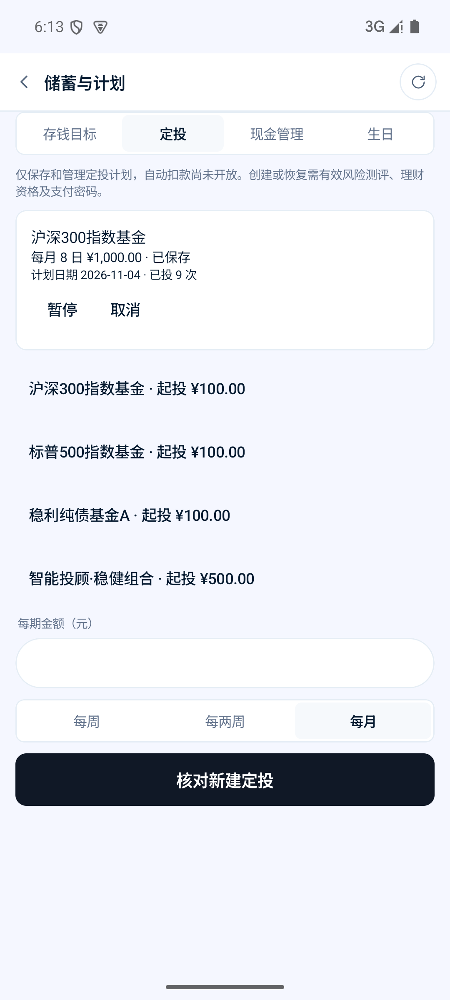

**4. 支出预算** — 原生复选框裸铺，首屏无提交

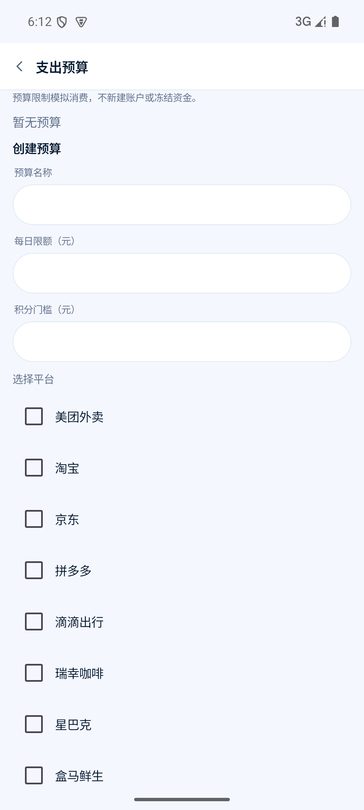

**5. IM 连接** — 三个按钮三种宽度，75% 空白

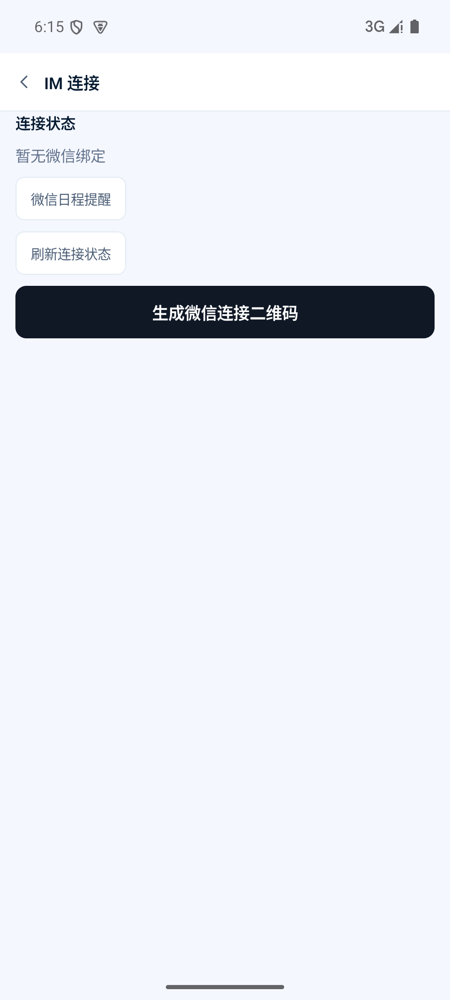

**6. 通知设置** — 居中灰字卡片，85% 空白

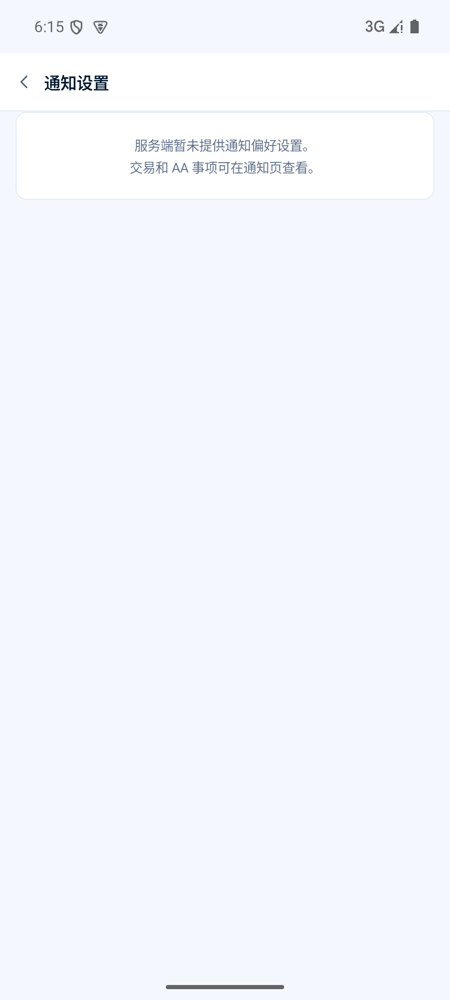

**7. 语言与地区** — 同上

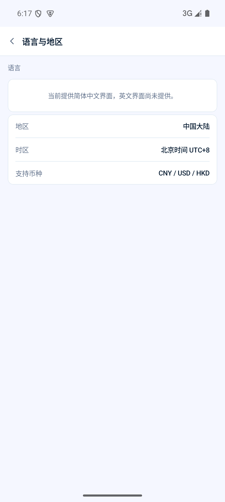

**8. 更多服务** — 图标重复/错用，全部裸铺

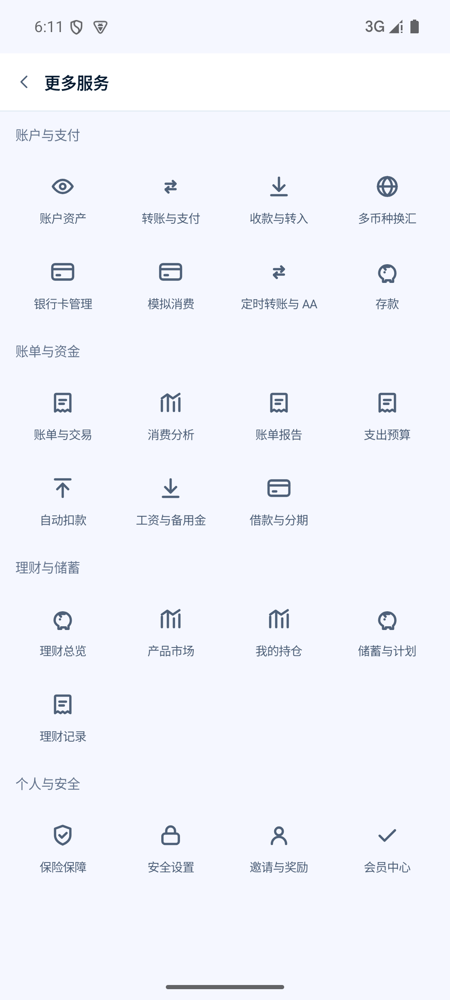

**9. 消费分析** — 柱与标签错位，环形图缺口

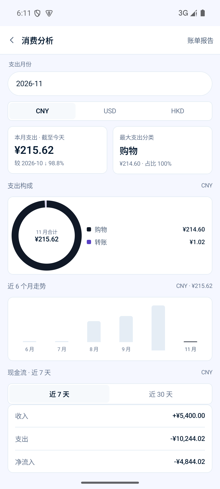

**10. 填写金额** — 分段器方形内嵌块，报价卡全 `—`

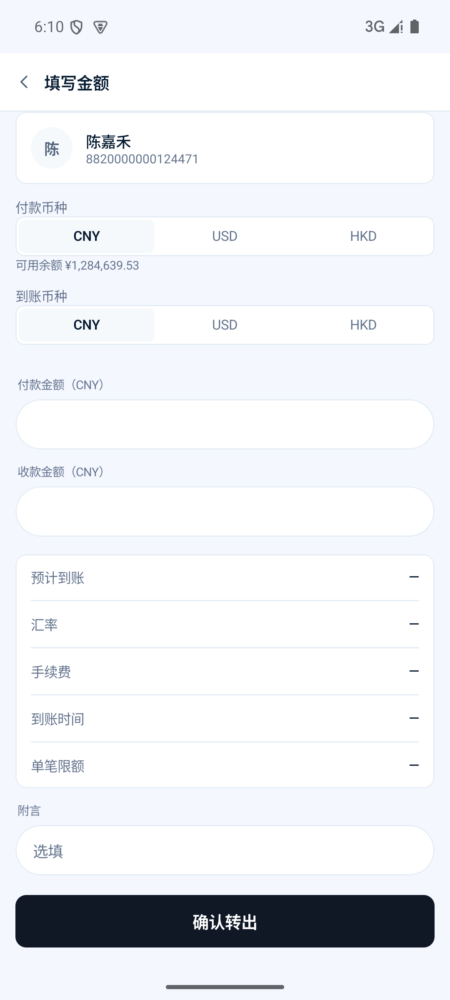

**11. 确认转账** — 11 行平铺，`收款标识` 明文卡号

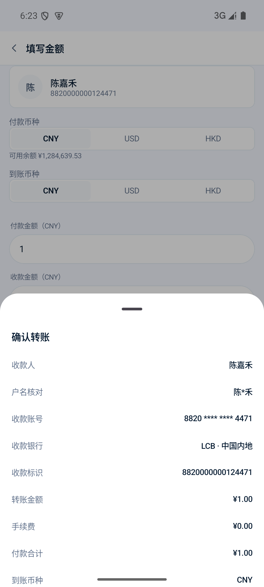

**12. 账单报告** — `5 笔` 断行，进度条 1px

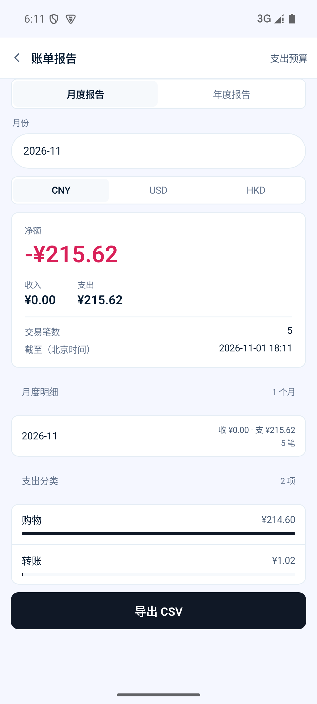
