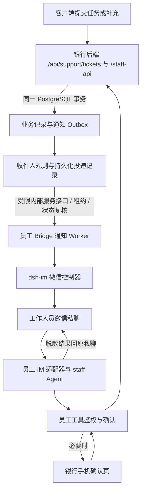

# 工作人员端 IM 机器人设计方案

日期：2026-10-21（北京时间）

状态：方案主体已开发；默认关闭，尚未上线或发送真实微信消息。当前代码、配置及首期边界见 [工作人员 IM 维护说明](../api/staff-im.md)。

下文保留原设计目标和开发前差距，涉及“现有/需补齐”的基线描述代表设计起点；当前完成情况以维护说明和验证记录为准。

范围：客服 `csr`、主管 `supervisor`。运维暂不接入。

## 1. 目标与方案选择

沿用客户端 IM 的接入方案、连接页面、文字对话、银行页面确认及结果回传机制，为客服和主管增加微信工作入口。业务执行复用现有员工 Agent 和 `/staff-api/`；客户任务创建、补充和转派后，由业务事件自动触发微信提醒。

核心体验：**工作人员一次连接微信并开通任务提醒，此后无需打开工作网页，也能收到相关客户任务；收到提醒后，可以在微信发起处理，通过银行页面完成必要确认，再回到原微信私聊查看结果。**

“能够完成现有操作”指通过 IM 发起、补充信息、打开确认页、执行并回传结果的完整闭环。查询可在有效登录下直接回复；写操作继续使用员工确认卡，代客办理保留独立客户核验。

本方案作出以下设计选择：

- 首期交付微信私聊；复用现有 `@xmanrui/dsh-im@5.1.0` Controller、Runtime 和扫码协议，不修改第三方源码。企业微信适配结构保留，首期不作为验收渠道。
- 客户端和工作人员端共用接入组件与机制，分别维护身份、机器人实例、凭据目录、会话和权限。工作人员使用现有 `staff` profile 与 8789 Bridge。
- 自动提醒由银行业务事务产生，使用固定模板，经现有微信主动发送能力投递；不依赖模型运行，也不依赖网页轮询。
- 新工单默认进入公共待处理队列，提醒值班客服；已经分配的工单提醒当前负责人；转派、审批和超时升级按主管规则处理。提醒收件人和工单负责人分别记录。
- 提醒开通授权独立于员工短期业务登录。退出网页不停止已开通的任务提醒；停用提醒、解绑、角色失效会停止后续发送。业务登录失效后，查询和操作须重新登录。

## 2. 当前实现基线

以下是读取当前源码得到的事实，实施时须区分“已有能力”和“本方案新增能力”。

| 领域 | 当前已有 | 本方案需要补齐 |
| --- | --- | --- |
| 客户 IM | 页内微信扫码、确认绑定、私聊、查询授权、网页确认、结果回传 | 提取可配置的接入组件与身份适配器 |
| 员工 Agent | 独立身份、会话、员工确认卡、客户核验；15 项注册工具中 14 项为业务工具，另 1 项仅运维 | 为客服和主管接入 IM；不加载运维工具 |
| 工单操作 | 查询、创建、留言、接手、等待、解决、挂起、恢复；网页可转给固定演示主管 | 员工目录、合法转派目标、Agent 转派、原子接手、服务端版本控制 |
| 审批 | 查询与处置；后端和前端 API 契约具备创建审批接口 | Agent 创建审批工具。现有网页没有创建审批入口 |
| 查询统计 | 工单后端列表最多 100 条，Agent 通常最多展示 30 条；工作台由受限列表计算 | 服务端分页、筛选和准确聚合，明确结果范围 |
| 客户端日程提醒 | 用户确认后保存一次性日程，使用原微信控制器投递；任务库按客户隔离 | 新增员工业务事件通知，不直接套用客户日程任务库 |
| 通知基础设施 | 当前工作人员页面约每 3 秒刷新 | 事务事件、收件人路由、通知记录、投递状态、重启恢复 |

现有 `demo-server.mjs` 只在非员工模式加载客户 IM。不能仅打开客户 IM 开关，就把工作人员端当作已经接入。

事实依据：[员工 API 契约](../../staff/src/api/contract.ts)、[工具定义](../../framework/packages/staff-tools/src/definitions.mjs)、[员工工具执行与确认](../../framework/bridge/staff-agent.mjs)、[客户工单接口](../../server/support-api.mjs)、[工作人员接口](../../server/staff-api.mjs)、[IM 适配器](../../framework/bridge/im-bank.mjs)、[渠道控制器](../../framework/bridge/im-channels.mjs)。

## 3. 角色与功能覆盖

| 能力 | 客服 | 主管 | IM 交互与执行要求 |
| --- | --- | --- | --- |
| 工作台、待处理、我的待办、等待客户、已解决 | ✓ | ✓ | 查询实际聚合与分页结果，显示筛选条件和统计时间 |
| 客户搜索、客户资料和已有业务记录概要 | ✓ | ✓ | 有效员工登录；查看详细资料必须填写查询事由并审计；返回脱敏内容 |
| 工单列表、详情、客户补充、关联记录 | ✓ | ✓ | 按编号、状态、负责人等查询；客户提交内容作为业务资料处理 |
| 创建工单 | ✓ | ✓ | 核对客户、渠道、事由和优先级，确认后创建 |
| 接手、等待客户、解决、挂起、恢复处理 | ✓ | ✓ | 展示目标工单及最新状态，确认后按原状态机执行 |
| 转给主管 | ✓ | ✓ | 从后端合法主管列表选择；确认后原子修改负责人 |
| 指定其他客服接手、调整值班接收池 | — | ✓ | 本方案新增管理能力；目标须为有效业务员工，不使用硬编码账号 |
| 工单留言、选择额外客户端收件箱提醒 | ✓ | ✓ | 确认完整正文、工单、客户及额外提醒开关 |
| 审批/在途处置查询 | ✓ | ✓ | 查询原记录及实际执行状态 |
| 创建审批申请 | ✓ | ✓ | 补齐已有 API 的 Agent 入口；确认后创建，主管不得审批本人申请 |
| 转账立即到账、拦截；其他审批通过、驳回 | — | ✓ | 查看真实原指令与截止时间，确认后执行；拦截理由使用后端枚举 |
| 代客锁卡、解锁、调单日限额、停用已有自动扣款 | ✓ | ✓ | 同一客户的在办工单、独立核验、真实目标及员工确认；不接收微信密码/验证码 |
| 查询延迟到账阈值 | ✓ | ✓ | 查询当前值及允许上限 |
| 修改延迟到账阈值 | — | ✓ | 展示当前值、新值及影响范围，确认后修改 |
| 审计记录查询 | — | ✓ | 返回授权范围内的脱敏分页记录 |
| 本人连接、提醒开关、通知记录 | ✓ | ✓ | 仅管理本人微信；绑定/停用/解绑均为明确页面操作 |
| 团队任务提醒规则、值班池和升级接收人 | — | ✓ | 确认后保存并记录规则版本；不允许改他人的微信归属 |

资料及资金口径沿用[账户模型](account-model.md)。IM 绑定关联已有员工身份，不建立客户账户；金额保留币种与整数分口径。

### 3.1 留言可见性必须准确表达

现有 `visibleToCustomer` 控制的是**是否额外投递到客户端收件箱**，不能包装成“内部备注/公开回复”开关：

- 客户自己创建的工单，其对话消息目前全部可由该客户查询，开关关闭也不代表隐藏。
- 员工主动创建的内部工单，客户目前不能通过客户工单列表查看整单；勾选额外提醒可以触达客户收件箱。
- IM 确认卡须显示工单来源、对话可见范围、是否额外提醒客户，不向员工承诺现有接口不具备的私密备注能力。

首期沿用这个真实语义。若以后增加真正的内部备注，应另设消息可见性字段、客户侧过滤和历史兼容规则。

### 3.2 既有业务约束

- 工单状态沿用 `open → processing/suspended`、`processing → waiting/resolved/suspended`、`waiting → processing/resolved`、`suspended → processing`；`resolved` 为终态。纯转派不改变状态。
- 客户在 `waiting` 工单补充消息时，当前业务会自动恢复为 `processing` 并保留负责人；发送补充提醒时引用这一实际结果。
- 代客办理沿用员工 Agent 更完整的核验要求，不在 IM 引入网页演示用的模拟核验。关联工单的客户、可办理状态和核验要求须在业务后端再次校验。
- 转账处置操作原有在途指令，不重新发起转账。普通审批的 `approved` 不代表 `executionStatus=succeeded`，回执分别报告。

## 4. 页面与交互

### 4.1 连接入口

工作人员侧栏新增「IM 机器人」，正式路径建议为 `/staff/im`，在独立开发服务器中为 `/im`。沿用当前客户端连接页的紫色主题、扫码面板、连接状态和确认交互，按员工角色加载业务文案。

页面包含三个区域：

1. **微信连接**：生成二维码、扫码状态、必要的渠道验证码、确认员工身份绑定、私聊激活、重连和解除。验证码只用于银行页面的微信扫码流程，不交给模型。
2. **任务提醒**：开通本人提醒、查看接收范围、值班状态及静默时段；主管另见值班池、升级接收人和规则配置。
3. **通知记录**：任务编号、事件类型、触发时间、投递状态、处理状态和打开工单。客服查看本人记录，主管查看授权团队的脱敏投递记录。

连接状态分别展示“未绑定”“待扫码”“待确认绑定”“待私聊激活”“可用”“需重登/连接异常”。仅机器人在线时，不直接显示“能够收到提醒”。

提醒投递状态与任务处理状态并列显示，例如“渠道已确认发送 / 工单仍待接手”。界面不提供无依据的“微信已读”。

### 4.2 首次连接

1. 工作人员登录工作人员页面，服务端核对当前角色为客服或主管。
2. 本人在页内生成微信二维码并扫码；二维码任务按员工归属隔离，沿用有效期、取消、验证码和生成限流机制。
3. 页面显示真实员工姓名、角色及当前微信连接。点击「绑定此微信并开通任务提醒」，同时明确提示提醒范围和退出网页后的持续提醒行为。
4. 员工给机器人发一条私聊，建立当前微信登录凭据对应的投递上下文。
5. 页面完成投递准备检查，显示本人连接及通知授权状态。若员工主动点击「发送测试提醒」，仅向该绑定发送一次不含客户信息的测试文字，并记录真实回执。

首期每位员工设一个主微信接收绑定；变更主绑定产生新版本。相同员工的普通业务登录刷新保留通知绑定版本，重新扫码、换绑和解绑使旧版本失效。禁止提交任意微信收件人 ID 来指定通知对象。

### 4.3 收到任务并处理

```text
【招财猫·新客户任务】
工单：T_…（普通 / 待接手）
类型：客户服务请求
时间：2026-10-21 15:20（北京时间）
请在银行查看详情并接手：<银行同源工单链接>
也可回复“查看工单 T_…”。接手以系统结果为准。
```

默认短模板只包含任务编号、通用事件类型、优先级、时间和银行链接。客户原文、姓名、手机号、卡号、余额和交易金额不直接放入自动微信提醒；经授权查看时再返回脱敏业务资料。每条模板控制在单条短文本范围，建议不超过 300 个汉字。

完整示例：

1. 客户提交任务，银行事务成功后产生新工单事件。
2. 当班客服收到新工单提醒，回复“查看工单 T_…”；登录失效时，先在银行页面恢复员工业务登录。
3. 机器人查询实际工单；员工回复“接手”，页面展示接手确认卡。确认后原子认领，成功才答复“已由你接手”。
4. 员工提出回复或代客操作；确认卡核对完整内容，代客办理另完成核验。执行后回传实际回执。
5. 客户补充资料时只提醒当前负责人；转派主管成功后只把后续提醒路由给新负责人。
6. 工单解决后停止该轮催办；已发出的微信消息仍可点击，但打开时显示最新状态。

微信里的“确认”“核验通过”等普通文字不消费业务授权。银行确认页操作完成后，结果回到同一员工、同一机器人和原私聊。

### 4.4 确认页

复用 `StaffConsentCard` 以及已有会话确认、问题补充和停止接口。提供手机可用的轻量确认页，建议入口 `/staff-agent-api/im#session=…`；沿用同源 HTTPS、内存令牌与退出清理，不要求重做整个桌面工作人员站。

确认链接仅用于定位会话或工单，不携带员工 Bearer、客户凭据或可直接执行的授权。未登录先进入员工登录；返回后重新校验会话归属、当前角色、工单版本和挑战有效期。

## 5. 总体架构



职责划分：

- **银行后端**维护权威员工角色、工单、审批、业务幂等、版本、Outbox 和通知状态，确定谁可以收到什么事件。
- **员工 Bridge**维护独立员工会话及微信凭据，复用原员工 Agent；独立通知 Worker 即使模型不可用也可以投递。
- **IM 渠道适配器**复用 `im-channels.mjs` 的 `deliver → sendProactiveText`；不复用要求内存登录会话存活的客户 `im-bank.send()` 来发后台通知。
- **通知内部接口**使用专用服务身份，只允许领取、复核和报告通知；不授予客户查询、员工写操作、终端或通用 Agent 权限。仅回环/受控网络访问，公网反代不暴露该内部路径。
- **模型**只处理员工明确发起的对话和工具调用，不决定提醒是否发送、发给谁、何时升级，也不生成通知自由正文。

客户端现有按客户分隔的 SQLite 日程库继续处理客户主动设置的日程。员工通知记录使用业务 PostgreSQL，使任务写入与事件写入可以原子提交。

## 6. 身份、登录和通知授权

### 6.1 两种授权分开管理

| 项目 | 员工业务登录 | 任务提醒授权 |
| --- | --- | --- |
| 用途 | 查询、提出操作、在页面确认业务 | 将相关任务的最小模板发到本人已验证的微信 |
| 身份来源 | 现有员工登录；每次核对当前数据库角色 | 已确认的员工绑定、主接收路由、授权版本及当前规则 |
| 持久化 | Bearer 只在服务内存，重启后须重新登录 | 持久保存员工 ID、绑定版本、授权状态、开通/撤销时间 |
| 网页退出 | 业务会话和未消费确认失效 | 继续有效，页面提前说明 |
| 能否操作业务 | 在权限和确认条件满足时可以 | 不能用于查询客户详情或执行任何业务 |

当前 `/staff-api/me` 使用登录会话里的角色快照，仅调用它不足以保证权限变更及时生效。实施需让员工业务鉴权核对 `staff_users` 当前记录和角色，增加员工权限版本 `auth_version`，并为 IM 增加独立的启用、撤销、版本字段。角色或凭据变更时递增权限版本，使旧会话及未消费确认失效；所有修改入口须统一维护版本。不声称现有系统已经有完整员工停用体系。

员工记录不存在、角色变为 `ops`、IM 授权停用或绑定撤销时，通知资格失效；主管降为客服后，后续主管类通知和处置权限立即按新角色检查。

### 6.2 隔离与撤销

- 路由身份至少包含 `audience=staff + channel + botId + privateConversationKey`，绑定目标为服务端核实的 `staffId`。客户 ID 与员工 ID 即使同值，也不能复用绑定或会话。
- 客户端与员工端使用独立渠道实例、存储和密钥派生域。微信平台凭据存在兼容或互斥问题时显示冲突，不接管现有客户连接。
- 主管只能配置哪些有效客服或主管进入接收池，不能替他人绑定微信。首期不开放机器人全局管理和企微 Bot Secret 管理给业务员工。
- 发送前检查通知授权、当前角色、路由版本及任务当前负责人；普通查询和写入还检查有效员工登录及业务权限。
- 解绑、换绑、取消通知时，停止未发送通知并撤销未消费的 IM 确认。普通员工重新登录只恢复业务会话，不重放过去指令。
- 群聊不办理业务、不接收任务提醒；图片和文件办理继续通过原工作人员网页入口。

## 7. 工具接入与确认规则

### 7.1 复用与补齐清单

复用现有 14 项客服/主管业务工具，包括客户、工单、审批、代客办理、阈值及审计。此次不挂载 `staff_operations_overview` 或原生运维工具。

| 工具或接口改动 | 设计 |
| --- | --- |
| 新增 `staff_get_workbench` | 读取服务端真实聚合；明确统计范围、截至时间与待办过滤 |
| 扩展 `staff_list_tickets` | 支持负责人、来源、优先级和分页；不把最近 30 条当全部工单 |
| 新增 `staff_list_assignees` | 读取后端按当前员工权限生成的合法转派目标；客服仅列主管，主管可列客服与主管 |
| 新增 `staff_assign_ticket` | 必须带工单版本和目标；核对目标存在、角色、可接收状态，确认后转派 |
| 扩展 `staff_update_ticket_status` | 接手和状态变更必须带版本；接手使用原子条件更新 |
| 扩展 `staff_post_ticket_message` | 增加是否额外提醒客户的明确布尔参数，补充工单来源和可见范围展示 |
| 新增 `staff_create_approval` | 接通已有创建接口；仅接受按业务类型验证的字段，禁止任意 `payload` 直传 |
| 扩展审批列表与处置 | 后端真正执行状态过滤和分页；确认保留拦截原因枚举、补充说明和备注 |
| 新增通知查询工具 | 员工查本人通知和接收设置；主管可查授权团队的投递摘要 |
| 提醒设置与开关 | 首期走本人连接页面；主管规则配置走结构化表单并确认，避免模型静默修改 |

### 7.2 查询和写入

**IM 查询白名单**：工作台、工单列表及详情、客户搜索及按事由查看概要、审批列表及详情、阈值、主管审计、本人连接与通知状态。只有有效员工登录、有效绑定、角色允许、服务端完成参数核对、GET 且无敏感请求体时，才可为本轮真实查询颁发一次查询授权并留痕。

这是员工 IM 的新增行为；现有员工 Agent 的所有工具仍走确认，不能把查询免逐次确认写成当前已支持。普通员工网页保持原确认策略。

**所有写入**：确认绑定、开关、设置或业务写入都需要对应的明确页面操作。Agent 业务写入复用现有一次确认，授权绑定员工、角色版本、会话、运行轮次、工具、参数指纹、资源版本和有效期。客户身份核验由员工在确认页完成，不让模型代填。

重试与重复点击必须使用同一个业务 `requestId` 查询原结果；确认已经消费后不再执行。工单或审批版本变化、截止时间已过时，返回冲突并展示最新状态，重新准备确认。

### 7.3 并发接手与转派

现有工单状态更新是读取后无条件更新，实施时必须改为数据库原子条件更新。接手条件至少包含：`工单ID + expectedVersion + 当前open + 负责人为空 + 当前有效员工`。

同一工单并发接手只允许一个成功，其他请求返回 `409 TICKET_ALREADY_ASSIGNED` 或 `409 STATE_CHANGED`。指定了负责人的 `open` 工单，只允许当前负责人或主管按规则开始处理。转派同样校验版本，并在一个事务内修改负责人、增加版本、记录审计和写入转派事件。

普通客服对已经分配给他人的工单保留授权查询能力，写入须转给负责人或由主管接管。现有后端写操作须统一应用此规则，防止通过网页旧入口绕过。主管每次接管和重分配都记录原因。

## 8. 自动提醒规则

### 8.1 触发事件与收件人

“收到客户任务”以银行成功保存的工单或客户消息为准；未提交的普通客户聊天不会触发工作人员微信提醒。

| 事件 | 接收人 | 处理规则 |
| --- | --- | --- |
| 客户新建未分配工单 | 当前有效值班客服接收池 | 私聊分别投递；不自动占单。池为空时转配置的值班主管 |
| 工单已指定负责人 | 当前负责人 | 不再向公共客服池扩散 |
| 客户在工单追加消息 | 当前负责人；无负责人按公共队列规则 | 短时间连续消息合并成“有 N 条新补充”，不复制客户原文 |
| 工单转派 | 新负责人 | 收件人必须与提交成功后的负责人一致；旧负责人待发提醒停止 |
| 新增待处置审批/在途记录 | 有权且非申请人的值班主管 | 由后端真实处置记录生成，不依赖客户或模型描述 |
| 长时间未接手或未响应 | 当前责任人/值班池；达到升级线再通知主管 | 仅对当前仍需要动作的状态计时，按通知阶段去重 |
| 工单解决或审批完成 | 默认只更新处理记录 | 停止催办；原申请人需要结果时可按单独订阅通知 |
| 绑定或渠道不可投递 | 本人页面和主管投递面板 | 显示原因和未通知任务，不把失败当作已经通知 |

同一事件同一员工通过多个规则命中时只生成一份通知。客户工单事件与员工内部工单事件保留来源字段；内部工单默认不触发“新客户任务”广播，但真实转派和主管待处置事件仍按对应规则通知。

**已分配任务的备用路径**：负责人未绑定、停用提醒或权限失效时，立即产生一次“负责人暂不可微信触达”的备用主管通知；可恢复的离线/上下文故障持续 2 分钟后进入同一备用阶段。本人静默期间，普通提醒先延后，但原任务响应期限继续计时，到期走备用主管。备用通知只提示主管协调处理，不改变工单负责人；主管接管仍须确认和原子更新。审批类备用主管同样排除申请人。无合格备用时保留 `waiting_recipient` 并在面板显示缺口，不能改发给无权人员。每个任务轮次的备用阶段只生成一次，不由每次检查反复创建。

### 8.2 值班与时间

现有系统没有值班表或自动派单。首期新增由主管维护的“接收池 + 可接收时段 + 备用主管”，不将员工网页是否在线作为值班判断。启用团队自动提醒前，配置至少一条有效接收规则和备用路径。

以下为建议默认值，属于设计参数，实施时可配置：

| 参数 | 默认设计 |
| --- | --- |
| 正常在线投递目标 | 业务提交后 10 秒内调用微信渠道；不承诺手机实际到达时间 |
| 普通工单 | 5 分钟仍未接手再提醒；15 分钟仍未接手升级主管 |
| 加急/VIP 工单 | 1 分钟仍未接手再提醒；3 分钟升级主管 |
| 客户连续补充合并窗口 | 30 秒；首次新任务提醒立即进入队列 |
| 静默时段 | 初始不设静默；员工可设置，主管可预览规则影响 |
| 接收方数量 | 公共队列默认最多 10 位值班客服；超限须缩小配置，不任意截断 |

未响应计时由**第一条尚未得到有效业务回复的客户消息**开启持久化 `responseCycleId`，固定 `cycleStartedAt`；后续客户补充只增加该轮消息数，不重置起点。员工成功发布到该客户可见渠道的有效业务回复，或明确进入等待客户状态时关闭本轮；仅打开通知、查询、内部工单留言而未触达客户、发送失败均不关闭。下一次客户补充才开启新轮次。转派不重置现有客户响应时限。

未接手任务另有持久化 `assignmentCycleId`，从本次进入待接手队列开始计时，成功开始处理后关闭；未响应催办与待接手催办分别按轮次记录，不把两种计时混用。

本人静默期间的普通新通知合并留待恢复时提示；备用收件规则继续计算。加急/VIP 是否允许越过本人静默，须在开通页面单独明示并由本人开启。无人符合接收规则时保留 `waiting_recipient`，主管面板突出显示；恢复值班后重新路由，不静默丢弃。

转账处置不直接使用普通工单分钟数。提醒必须读取真实 `holdUntil` 和处置状态；剩余窗口允许时可在截止前再提醒一次。窗口不足时只发当前一次，窗口结束后停止催办并查询真实终态。没有人工处理不代表系统拦截或批准。

### 8.3 去重和投递状态

业务事件以事务写入的 `eventId` 唯一；逻辑通知使用以下稳定去重键：

- 一次性创建、转派、审批事件：`eventId + recipientStaffId + notificationKind`。
- 待接手、未响应及不可触达升级：`resourceId + assignmentCycleId/responseCycleId + recipientStaffId + notificationKind + escalationStage`。定时扫描只推进既有轮次，不为同一阶段反复创建新业务事件。
- 客户补充合并通知：`responseCycleId + mergeBatchId + recipientStaffId + notificationKind`。首条补充建立一个持久化的 30 秒批次，窗口内合并，窗口结束后关闭；下一批以新的真实客户消息开启，不由扫描凭空创建。

绑定版本记录在投递快照中，不通过换绑生成同一事件的新通知。规则修改时重新计算尚未发送的收件人：仍合格的同一员工保留通知 ID 并更新规则快照；失去资格者抑制；新合格员工按原事件/轮次创建自己的唯一通知。不能因规则版本变化直接取消全部待发通知。已经 `sent/unknown` 的通知不因规则重算重发，主动解绑或换绑产生的旧通知也不自动迁移到新绑定。

| 状态 | 含义与恢复策略 |
| --- | --- |
| `queued` | 已生成通知，等待可用 Worker |
| `waiting_recipient` | 尚无符合当前规则的收件人；继续路由并在面板告警 |
| `deferred` | 静默期等待；恢复时合并，并复核任务是否仍需处理 |
| `retry_wait` | 确认尚未调用发送，例如机器人离线、缺少私聊上下文；退避重查 |
| `sending` | 已记录发送尝试，即将或正在调用渠道；不允许其他 Worker 重复发送 |
| `sent` | 微信渠道明确确认接受本次发送；不等于手机送达或已读 |
| `suppressed` | 任务已处理、负责人变更、规则重算后失去资格、权限或绑定失效；停止该旧通知 |
| `expired` | 已超过业务有效窗口；不再投递旧催办 |
| `failed` | 参数无效、明确不可恢复，或发送前检查重试耗尽；记录原因并进入面板 |
| `unknown` | 已进入发送但结果不确定，包括超时、部分发送或进程中断；不自动重发 |

可恢复的发送前检查建议按 15、30、60、120 秒递增，随后最多每 5 分钟重查；最多 20 次，并受任务有效窗口约束。缺少私聊上下文时明确显示“需先给机器人发送一条消息”，不伪装为渠道已经可用。

Outbox 领取租约超时、且尚未进入 `sending` 的工作可以重领；遗留 `sending` 转为 `unknown`。进入渠道调用后的异常保守按不确定处理，除非适配器能证明请求根本没有发出。多 Worker 使用数据库租约和版本令牌，只允许当前租约持有者推进状态。

不确定发送不自动重发同一通知。后续达到独立升级阶段时可以产生一条有新去重键的主管通知，其内容标明前一通知投递不确定；同一员工同一阶段仍只生成一份。需要人工重发时，在通知面板确认后建立可审计的新尝试，提示可能重复。

取消、解绑或任务解决只能阻止尚未交给微信的发送；已经交给渠道的消息可能仍会到达，不能承诺撤回。通知与当前业务状态之间仍可能存在发送瞬间的竞态，所有链接打开和实际操作均以最新记录为准。

## 9. 数据与内部接口设计

本节全部为拟新增或扩展的契约，不代表当前接口已经存在。

### 9.1 数据模型

| 数据 | 最小字段与约束 |
| --- | --- |
| 员工权限版本 | 在 `staff_users` 增加 `auth_version` 或等价权威记录；角色/凭据修改原子递增，业务会话和确认绑定该版本 |
| `staff_im_bindings` | `id, audience, staff_id, channel, route_ref, recipient_hash, binding_revision, status, is_primary, created_at, revoked_at`；每员工一个有效主绑定；同一私聊不得绑定不同员工 |
| `staff_im_authorizations` | `staff_id, enabled, grant_version, binding_revision, granted_at, revoked_at`；只能授权本人通知；不保存员工 Bearer |
| `staff_notification_preferences` | 本人启用事件、静默时段、加急越过静默开关及版本；时区固定为 `Asia/Shanghai` |
| `staff_notification_rules` | 主管配置的值班客服池、有效时段、备用主管、升级参数、版本、修改人及审计关联 |
| `staff_notification_outbox` | `event_id, event_type, resource_type, resource_id, resource_version, source, occurred_at, available_at, rule_version, status`；和业务写入同一事务，不存客户原文 |
| `staff_task_reminder_cycles` | 资源 ID、轮次类型、稳定 `cycle_id`、固定起点、下次检查、阶段及关闭时间；记录待接手/未响应轮次和持久合并批次，不按扫描重新建轮次 |
| `staff_notifications` | 逻辑通知去重键、关联事件/合并批次、收件员工、绑定/授权/规则版本、当前状态、下一次检查、过期时间；无收件人时先保留路由状态 |
| `staff_notification_attempts` | 通知 ID、唯一尝试 ID、租约/版本令牌、开始/结束时间、渠道回执 ID、结果及脱敏错误码；不存渠道凭据 |
| 业务版本与幂等 | 工单新增单调版本；审批处置保留等价并发校验；员工写入增加请求编号与参数指纹、结果记录，防重复操作 |

数据库只存路由引用及接收身份指纹。微信凭据、真实路由和上游上下文保存在员工 Bridge 独立受保护目录；沿用加密凭据机制，不把上游整个状态目录描述成全部已加密。

业务数据库中的绑定状态为授权依据，渠道侧关联先准备再激活；跨存储绑定未完成时保持 `pending`，不给通知或业务权限。解绑先撤销数据库授权再清理渠道；恢复或版本不一致时停止投递并要求核对，不恢复旧授权。

### 9.2 对员工开放的接口

工作人员 Bridge 通过现有同源反代前缀 `/staff-agent-api/` 暴露能力。建议新增：

| 拟定接口 | 权限与用途 |
| --- | --- |
| `GET /staff-agent-api/im` | 加载员工登录、绑定、问题补充和确认的轻量页面 |
| `POST /staff-agent-api/im/weixin/qr` | 当前客服/主管生成本人的扫码任务 |
| `GET /staff-agent-api/im/weixin/qr/:id` | 仅本人查看扫码状态 |
| `POST /staff-agent-api/im/weixin/qr/:id/verify` | 仅本人提交本次扫码所需的渠道验证码 |
| `POST /staff-agent-api/im/weixin/qr/:id/cancel` | 仅本人取消 |
| `POST /staff-agent-api/im/weixin/qr/:id/confirm` | 本人明确确认身份绑定及通知授权，幂等处理 |
| `GET /staff-agent-api/im/bindings` | 查看本人连接、激活状态及登录状态 |
| `DELETE /staff-agent-api/im/bindings/:id` | 本人确认解绑，递增绑定版本并停止旧通知 |
| `POST /staff-agent-api/im/bindings/:id/test` | 本人明确点击后发送一条无客户信息的测试文字 |
| `GET/PATCH /staff-api/im/notification-preferences` | 当前员工读取或明确保存本人接收设置，写入带版本和请求编号 |
| `GET /staff-api/im/notifications` | 本人通知分页；主管可查询经授权的团队投递摘要 |
| `GET/PUT /staff-api/im/notification-rules` | 主管读取/保存接收池、时段及升级规则 |
| `GET /staff-api/assignees` | 当前员工可选择的合法接收人，按角色过滤 |
| `GET /staff-api/workbench` | 真实统计及截至时间，不依赖截断列表 |

二维码和绑定接口复用客户端所有权、限流、一次绑定码和原子认领机制，身份改为工作人员。员工登录仅转发固定 `/staff-api/login`；确认、答题和停止继续复用员工 Bridge 现有会话接口，不新增微信文字批准接口。

已有工单列表、状态、消息和审批接口扩展分页、筛选、版本与幂等字段。新转派工具可以复用工单状态接口，但必须先补齐后端目标校验和原子更新。

### 9.3 Worker 内部接口

在银行后端建立独立内部命名空间，例如 `/internal/staff-im-notifications/`，仅供员工 Bridge 的通知 Worker：

1. `claim`：按限额领取待路由事件或通知，返回租约和版本令牌；重复领取受数据库唯一约束保护。
2. `prepare`：复核业务状态、员工当前角色、接收规则、本人授权、绑定版本和有效时间，返回固定模板及路由引用。
3. `begin-send`：再次复核员工资格、当前负责人/状态、通知和绑定版本、有效窗口及当前租约，原子记录唯一发送尝试并进入 `sending`；Worker 只有拿到明确成功响应后才可调用渠道。该响应不确定时不发送，交由恢复流程标为 `unknown`。
4. `complete`：使用相同尝试 ID 和版本令牌幂等报告 `sent/unknown/not_attempted` 及渠道回执。`not_attempted` 仅限该 Worker 能确定尚未调用渠道控制器的情况，例如本地路由已失效；银行端复核后转 `retry_wait/suppressed/failed`。一旦调用控制器，其异常统一按 `unknown` 处理。完成报告失败时只重报相同尝试的状态，绝不再发微信。

Worker 在 `begin-send` 后立即校验本地路由及当前凭据上下文，再调用控制器；若确认未调用渠道便发现不匹配，可报告明确的发送前失败。服务身份限制到上述通知方法，采用可轮换的服务密钥、签名、时间窗口和重放防护，拒绝浏览器使用及任意收件人/自由文本请求。

绑定/本人设置的查询和撤销也需有受限的服务端协作接口，供 Bridge 在验证员工登录后调用；服务间请求必须携带经核实的员工主体，银行端再次核对，不信任浏览器自报 `staffId`。

## 10. 实施顺序与代码落点

整体功能完成标准是客服与主管业务闭环及自动提醒都通过验收；以下按依赖拆分，便于逐步实现。

| 步骤 | 主要代码落点 | 完成结果 |
| --- | --- | --- |
| 1. 员工业务基础补齐 | `server/staff-api.mjs`、`staff/src/api/contract.ts`、HTTP/mock 适配；`framework/bridge/staff-agent.mjs`、员工工具定义 | 当前角色复核、原子认领/转派、目标校验、代客后端核验、版本/幂等、分页/聚合 |
| 2. 员工 IM 接入 | `framework/bridge/demo-server.mjs`、`staff-server.mjs`；新增员工 IM 身份适配器，复用 `im-channels.mjs` 和扫码机制 | 客服/主管独立扫码、绑定、会话、查询、确认及结果回传 |
| 3. 全功能工具映射 | `framework/packages/staff-tools/src/definitions.mjs`、`framework/bridge/staff-agent.mjs` | 转派、创建审批、留言额外提醒及统计等缺口补齐；写操作一次确认 |
| 4. 可靠任务通知 | `server/support-api.mjs` 客户创建/补充事务；`server/staff-api.mjs` 转派/审批/终态事务；新增通知模块与 Worker | 持久化事件、路由、去重、静默/升级、微信主动投递与恢复 |
| 5. 页面与契约 | `staff/src/App.tsx`、导航、新 IM 页面及共享连接面板；手机轻量确认页 | 同客户端的连接体验、本人设置、主管规则、投递记录和异常提示 |
| 6. 联调与维护 | 员工/IM/通知专项测试、维护文档、知识与技能 | 模拟渠道全链路及单独记录的真实微信验收，启用/停用和备份方案 |

优先把事件写入现有客户工单 `mutation()` 事务内部，使客户重试不重复生成提醒。员工侧状态和转派也应先统一事务，再产生事件。不得仅在页面“提交成功”回调或模型回复后追加通知。

功能开关建议：`LUCKYCAT_STAFF_IM_ENABLED` 控制员工渠道，`LUCKYCAT_STAFF_IM_NOTIFICATIONS_ENABLED` 控制自动提醒。关闭提醒停止新投递并保留记录；停机或重新启用前先确认历史 `sending/unknown`，不批量重发旧消息。

通知元数据随 PostgreSQL 备份；员工渠道凭据、映射和相应密钥另按现有 IM 目录规则备份。恢复演练必须核对事件进度、绑定版本和投递尝试；历史发送不确定时保持 `unknown`，不从旧快照重新广播。

## 11. 验收标准

| 场景 | 必须观察到的结果 |
| --- | --- |
| 同客户端的连接体验 | 本页扫码、验证码、明确绑定、私聊激活、重连、解绑；他人的二维码与连接不可读写 |
| 客服与主管全部业务 | 第 3 节业务操作通过真实员工工具闭环，绑定和设置管理通过对应结构化页面完成；处置、阈值、审计越权均由后端拒绝 |
| 一次开通后自动提醒 | 客户建单保存成功后，值班客服收到对应通知；不需要逐条批准提醒或保持网页打开 |
| 登录退出与服务重启 | 已授权且渠道上下文有效的提醒继续；客户资料查询和业务写入要求重新有效登录；旧指令不恢复 |
| 客户补充 | 自动恢复的实际工单状态正确；消息合并且只提醒当前负责人 |
| 并发接手与转派 | 多个客服同时确认，只有一个认领成功；转派目标真实合法，旧版本冲突，不覆盖新负责人 |
| 重试与事务回滚 | 相同客户/员工请求只生成一个业务结果和逻辑事件；业务回滚不产生通知 |
| 多 Worker 与重启 | 未发送工作可重领；同一尝试只由一个 Worker 调渠道；遗留发送状态转 `unknown` |
| 渠道断开或上下文丢失 | 显示具体不可投原因；仅发送前失败可退避；重新扫码后需私聊激活，旧绑定不自动迁移 |
| 通知状态准确 | `sent` 仅表示渠道确认；超时或部分发送为 `unknown`，不会显示微信已读或自动重发 |
| 处理完成和权限变化 | 解决/转派/撤权后的待发旧通知停止；原链接打开和操作始终重新检查最新状态 |
| 无人值班及静默 | 使用备用主管或保留待路由记录；静默、加急和升级规则按配置生效，不丢任务 |
| 催办与规则变更 | 连续补充不重置响应时限，重复扫描不重复升级；值班规则变更保留仍合格员工的待发通知，为新增接收人生成唯一记录 |
| 代客办理 | 关联同一客户的在办工单、独立核验、状态重验；模型不能代填核验结果，微信不收密码 |
| 留言与资金回执 | 准确显示对话可见范围和额外提醒；批准与实际执行结果分开报告 |
| 模型不可用 | 不影响已产生业务事件的自动提醒；员工对话明确显示暂不可用，不伪造处理成功 |

先使用隔离 PostgreSQL、模型协议夹具和模拟微信完成上述测试。真实微信验收另行由本人扫码，并在明确指定的本人私聊发送测试消息；以实际渠道回执单独记录结果，不将模拟通过写成真实送达。

## 12. 相关资料

- [当前客户 IM 接入](../api/im-agent.md)
- [当前客户微信日程提醒](../api/im-reminders.md)
- [当前工作人员 Agent](../api/staff-agent.md)
- [工作人员端维护说明](../../staff/README.md)
- [工作人员端既有功能清单](../../design/staff-console/工作人员端清单.md)（历史规格需结合当前实现核对）

本文定义后续工作人员 IM 的目标行为；现有部署状态仍以运行代码和对应验收记录为准。
