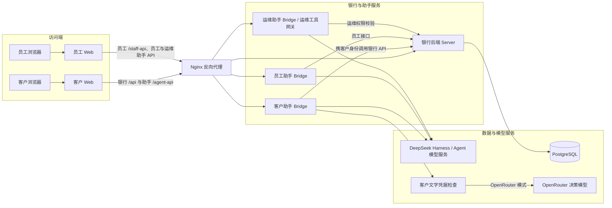
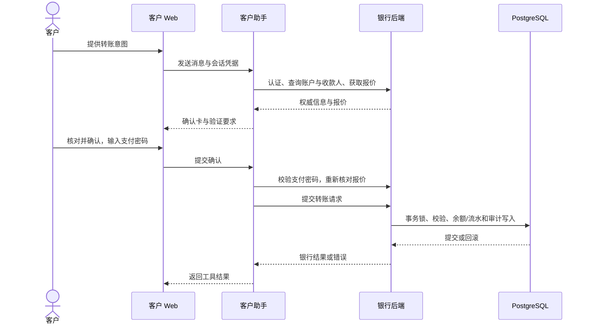

# 招财猫 Bank 技术文档

**版本：**1.2  
**日期：**2026 年 11 月 1 日  
**范围：**涵盖客户 Web 端、员工 Web 端、银行后端服务、数据库及智能助手（不含 Android 客户端）。

# 1 系统架构设计

项目官网：[https://bank.waveflow.men/](https://bank.waveflow.men/)

## 1.1 总体架构

系统主要由前端 Web、Nginx 反向代理、银行核心后端、智能助手桥接层（Bridge）和 PostgreSQL 数据库组成，整体调用关系如图 1-1 所示。

客户与银行员工分别通过各自的 Web 端访问银行服务或智能助手。Web 端发出的银行与助手请求由 Nginx 按路径转发至对应后端；助手侧在收到请求后，通过银行接口查询业务状态并执行已授权的操作。外部模型服务与文字凭据检查模块按需通过运行配置开启，图 1-1 仅列出核心调用链路。

**图 1-1 系统主要组件及调用关系**

## 1.2 组件职责与依赖关系

**银行后端（Server）** 在启动阶段完成 PostgreSQL 连接、客户认证、安全网关和员工 API 的初始化，并将各类请求分发至对应的路由处理器。处理客户请求时，系统先根据会话识别客户身份，再加载并激活对应的业务档案；涉及兼容层的业务操作统一通过队列串行执行，防止并发切换档案时出现数据串号。

**助手桥接层（Bridge）** 本身不维护账本数据，核心职责是会话管理与接口转发：它先校验助手会话的归属关系，再携带用户的银行 Bearer 凭据调用银行后端的资料与业务接口，并对返回结果做统一错误处理。真正的业务状态维护与身份权限边界仍在银行 API 一侧。此外，桥接层访问银行后端的 URL 仅允许使用 HTTPS 或本机回环 HTTP 地址。

客户、员工与运维 Agent 分别运行于独立服务进程，使用 `luckycat`、`staff` 和 `staff-ops` 配置。三者复用 DeepSeek Harness 与桥接公共代码，分别维护 `customer`、`staff`、`ops` 会话命名空间及附件目录，并共享银行后端。员工 Agent 按员工角色调用业务接口；运维 Agent 使用独立运维工具集及审批网关，对工具执行实施权限校验与审计。

## 1.3 核心运行流程

日常转账支持普通 Web 页面与智能助手两条入口：
- **Web 页面转账：**前端直接依次调用报价、收款人解析和转账提交接口。
- **智能助手转账：**在正式提交前增加了自然语言意图解析与用户确认环节（详见图 2-1）。

无论从哪个入口发起，最终都由银行后端统一完成支付密码核验、余额检查、收款人校验及业务状态更新。助手返回的文本回复仅用于交互提示，不能作为转账成功的最终凭据。

## 1.4 数据架构

核心账务与客户数据存储在 PostgreSQL 中，主要表结构设计如下：
- **客户与账户：**`customers` 与 `customer_credentials` 表分别存放客户基本信息及认证凭据；`bank_accounts` 采用“客户 + 账户”复合主键明确归属关系，账户余额与可用余额均以整数“分”为单位存储，并通过数据库 `CHECK` 约束严格限制币种与金额范围。
- **交易与总账：**`bank_transactions` 通过复合外键关联具体账户，记录交易方向、金额及状态，并建有按账户与时间维度的查询索引；底层的账户体系、分录批次、明细及余额变动则分别由 `ledger_accounts`、`journal_batches`、`journal_entries` 和 `balance_changes` 四张表承载。

为了复用既有业务规则，兼容层在请求入口处采用按需加载的 `scoped` 投影模式：先将目标客户的业务档案从数据库载入内存视图，待工作单元（Unit of Work）提交时再统一写回数据库。这种做法虽然兼顾了旧逻辑的兼容性，但也依赖锁机制与串行化队列来保证档案切换和数据写入的顺序；目前尚未对其高并发吞吐量与水平扩展能力做压测验证。

## 1.5 部署架构与环境约束

系统目前采用单机部署方案。Nginx 统一承担静态前端资源托管、HTTPS 接入及 HTTP 自动跳转，并将银行服务、客户助手和员工助手转发至本机不同端口。

在部署巡检中，各后端服务均正常运行，公网首页与登录页返回 `HTTP 200`，未携带凭据访问助手健康检查接口按预期返回 `HTTP 401`。不过，该巡检仅验证了服务连通性，尚不能替代完整的业务流程测试与全链路安全验证。

# 2 核心业务机制与算法说明

## 2.1 业务一致性设计思路

本系统的核心在于交易一致性保障与工程容错机制，不涉及自研新型算法。在转账场景下，系统不仅要防止网络重试、并发请求或中途报错导致账务错乱，还要确保用户最终提交时的手续费、汇率及收款方信息与确认时完全一致。为此，后端将银行请求封装在工作单元内，利用数据库事务、表级约束以及关键写操作的强制幂等机制来维持状态一致（注：相关机制目前已落地代码实现，但尚未开展并发实测）。

## 2.2 转账业务处理流程

转账接口接收付款账户、转账渠道、金额、收款方标识、币种及确认条件作为输入，执行成功后返回交易回执，失败则返回具体错误码。完整处理流程分为四步：

1. **询价与收款人解析：**根据付款账户和所选渠道计算手续费、交易限额及换汇信息；若为本行转账，还会核对收款账户与户名并返回脱敏后的收款人信息。
2. **密码与基础校验：**提交转账时，银行服务首先核验支付密码；随后由领域层校验金额是否为大于零的安全整数（以分为单位），并逐一核查渠道、收款行、收款人、币种、限额及可用余额。
3. **二次核价与冲突检测：**服务端重新核算手续费与汇率，比对用户提交的确认条件；若期间 FPS 登记信息等关键要素发生变动，接口将直接返回冲突错误，要求前端重新发起确认。
4. **大额在途冻结与定时解冻：**若交易触发大额在途规则，系统会先冻结相应可用余额；在预设时间窗口内，客户可主动撤回，员工也可介入处理；超出窗口期后，由后端定时任务自动推进后续入账流程（具体阈值、时间窗口及触发条件由配置项与代码逻辑决定）。

> **说明：**手续费、汇率及预计到账时间由系统内业务规则计算。

## 2.3 事务控制、幂等机制与异常处理

**事务与锁机制：**涉及兼容层的业务统一进入 `exclusive` 队列并开启工作单元。数据库层随即启动事务，获取 PostgreSQL 事务级咨询锁（Advisory Lock），加载内存视图并设置保存点（Savepoint）。业务执行成功则持久化变更并提交事务；一旦发生异常则回滚并还原内存缓存。针对支付密码错误这一特殊分支，系统会先回滚当前交易变更，再单独记录密码失败次数与账户冻结状态，避免错误交易被连带提交。需要注意的是，全局串行化虽然规避了并发切档风险，但也在客观上限制了吞吐能力，因此不能单凭现有代码宣称系统具备高并发处理能力。

**接口幂等设计：**对于列入 `IDEMPOTENT_METHODS` 的操作，当请求头携带合法的 `Idempotency-Key` 时，后端会结合客户 ID、幂等键、请求路径及规范化后的请求体（不含支付密码）进行比对。若判定为相同请求重试，则直接返回已缓存的处理结果；若同一幂等键被用于不同请求内容，则直接报错拦截。幂等记录的读写与核心业务变更处于同一个事务和锁边界内。列入范围的关键写操作必须携带 `Idempotency-Key`，缺少时拒绝提交；网页与助手负责提供操作编号，结果不明时先核查原操作。

## 2.4 智能助手转账工作流

智能助手基于 DeepSeek Harness 框架与可配置的大模型构建，本质上是对外部预训练模型的 API 调用与工具编排（Tool Calling），不涉及模型底层的训练或微调。通过助手发起转账的交互时序如图 2-1 所示：

**图 2-1 助手发起转账的交互时序**

具体执行分为两个阶段：
1. **询价与生成确认卡：**助手先调用银行接口查询账户状态与实时报价，组装出包含关键要素的确认卡片并设定有效期，返回给前端展示。
2. **授权核验与正式执行：**用户核对无误并输入支付密码后，助手在执行阶段会再次向银行后端核验密码并刷新报价；一旦发现手续费、汇率或收款人信息发生变动，立即中止操作并要求用户重新确认。

此过程中的执行授权与当前会话、具体工具调用、参数摘要及用户身份严格绑定，仅限有效期内单次消费，无法重复使用。若遇到网络抖动、报价过期、权限失效或用户主动取消，交易均会被阻断；交易最终是否成功，一律以银行后端返回的回执与交易流水为准。

# 3 安全设计

## 3.1 安全边界与信任模型

浏览器前端、智能助手、银行后端与数据库处于不同信任边界。用户填写的表单和模型生成的工具参数不会直接改变账户状态；转账等业务请求由银行后端校验用户身份和业务规则。数据库层负责数据约束与事务隔离，Nginx 负责入口流量分发。各层措施仍需结合端到端测试评估。

## 3.2 身份认证与权限控制

**客户侧认证：**客户登录成功后，系统会签发 32 字节的随机 Bearer Token，默认有效期为 12 小时；服务端数据库仅存储该 Token 的 SHA-256 摘要。会话过期、主动登出以及修改密码后强制下线其他会话的逻辑均已实现。密码存储采用随机盐值配合 `scrypt` 算法，同时向下兼容旧版 SHA-256 格式的密码校验（存量旧格式凭据是否已全部完成迁移尚待核实）。此外，客户服务端虽已按会话隔离业务档案，但全部路由及底层数据对象的越权边界尚未逐一完成代码审计。

**员工侧鉴权：**员工端接口内置了 `csr`、`supervisor` 和 `ops` 三类角色校验，部分工单接口还会进一步核对当前处理人身份；不过，员工权限检查在所有接口上的完整覆盖率仍有待逐项排查确认。

## 3.3 数据加密与隐私保护

数据库加密模块采用 `AES-256-GCM` 算法对调用方传入的敏感负载进行加密，并强制校验密钥格式；卡片敏感信息（Card Secret）在落库时同样调用该模块加密存储。

需要注意的局限性包括：
- **明文字段：**数据库表中仍保留了客户姓名、手机号、交易对手方等明文字段，因此不能视为全库加密。
- **日志脱敏：**交易自动分类模块的日志可能会打印交易对手方名称，后续需结合日志管理规范做脱敏审查。
- **传输与密钥：**仓库内虽提供了 HTTPS 部署配置样例，但生产环境实际的链路加密强度与密钥托管方案尚未现场核验。

## 3.4 业务风控与环境隔离

- **接口限流与验证码：**登录与短信接口均配置了请求频率限制。短信验证码采用随机数、盐值与摘要保存，并设有有效期和错误尝试次数上限；验证码接口会返回演示验证码。
- **防重与容错：**支付密码错误锁定、余额校验、数据库事务与强制幂等键共同降低了重复扣款和状态错乱的概率，具体防护范围以实际调用的代码路径为准。

## 3.5 智能助手（Agent）安全机制

助手端按操作类型区分只读查询、普通写入和需支付密码核验的工具。涉及资金等敏感操作时，确认卡片会向用户明示核心参数，生成的执行授权与参数摘要、当前会话强绑定，且仅限有效期内单次使用。正式提交前助手会二次核对关键业务数据，银行后端也会独立完成身份与密码校验。

### 客户文字凭据检查
为防止用户在对话中误发密码等敏感凭据，系统在前端与服务端设立了双重拦截机制：
- **前端预检：**客户 Web 端在发送消息前，先通过 `hasExplicitCredential` 规则检测输入文本中是否包含特定凭据名称及类似赋值的表达；一旦命中，立即弹窗引导用户改用安全验证窗口输入。消息发送后等待服务端响应期间，界面先展示占位文本；若被服务端拦截拒绝，则自动移除占位并尝试恢复用户刚才输入的草稿。
- **服务端审查：**客户聊天消息、历史记录导入、问题卡回复以及已绑定客户的 IM 文本在进入助手逻辑前，均需先过服务端检查模块。服务端先跑一遍相同的本地规则拦截明显凭据，再将剩余非空文本送入外部模型做安全判定：在 OpenRouter 模式下默认调用 `respan/span-02`，若遇服务异常、超时或返回格式不合法，则自动降级切换至 `perplexity/pplx-decider-v1.2`。只要模型判定为“不安全”或“不确定”，请求即被直接拒绝；正常返回的分类与概率值还需通过格式校验（默认安全概率阈值为 `0.5`）；若两个模型均无可用结果，接口返回服务不可用，不将该消息交由业务助手处理。注：`0.5` 这一阈值尚未结合实际业务语料做量化校准，不能直接等同于经过验证的漏检率指标或绝对安全承诺。

### 外部模型的数据边界与局限
- **文本外发风险：**未被本地正则规则命中的消息原文会发送至 OpenRouter 及其上游模型服务商；若本地规则发生漏判，用户夹杂在文本中的密码仍有可能随之流出。
- **多模态盲区：**该检查模块仅针对纯文本生效。纯图片消息（无附带文字）会直接放行，图片内容本身不会经过凭据扫描；语音消息则会先发往上游语音识别（ASR）服务，待转写成文字并作为消息提交时才会触发检查。

因此，客户应始终通过独立的确认卡片输入支付密码。上述机制主要提供基础防护，尚不能保证覆盖所有入口、图片/音频载体或复杂的提示词注入（Prompt Injection）攻击。

## 3.6 当前已知限制与待核实项

除上述各节提到的边界外，以下事项仍需结合实际投产环境进一步核实与完善：
1. **外部服务与合规边界：**短信通道、外部身份核验服务、合作金融机构接口的实际配置情况，以及第三方模型供应商的数据处理协议（DPA）与日志留存策略均有待确认。
2. **弱网重试与幂等覆盖：**助手端并非所有写操作都采用统一逻辑生成幂等键，银行后端已对列入范围的关键写操作强制要求幂等键，针对断线重连与弱网重试场景仍需开展专项测试。
3. **运维与审计：**数据库明文字段保护、日志脱敏策略、生产部署配置、细粒度角色权限矩阵及数据备份恢复演练，均需在正式上线前做全面审查。

# 4 项目创新点

## 4.1 技术创新

### 4.1.1 面向银行业务的可控 Agent 执行机制

基于 DeepSeek Harness 构建智能助手，将自然语言意图转化为受约束的工具调用。敏感操作经过参数展示、用户确认与支付密码核验，执行授权绑定会话及参数摘要，并限时、单次使用；提交前重新核对报价，形成从意图理解到业务执行的完整控制链路。

### 4.1.2 规则与多模型协同的凭据防护

在前端与服务端设置文字凭据检查，结合本地规则与 OpenRouter 决策模型识别敏感输入。主模型异常时自动切换备用模型，对不安全、不确定或无有效判定的消息予以拦截，引导用户通过独立验证窗口输入密码。

### 4.1.3 对话操作与账务一致性协同

助手与网页共用银行业务接口，业务结果以银行回执为准。通过数据库事务、锁、约束和关键写操作强制携带的幂等键，将余额、流水及审计记录纳入一致性控制，并在手续费、汇率或收款信息变化时要求重新确认。

## 4.2 功能创新

### 4.2.1 对话式银行业务办理

用户通过自然语言查询账户、交易记录并发起转账。助手补全必要信息、展示业务确认卡片，再根据授权执行操作，将多步骤表单流程组织为连续对话。

### 4.2.2 多模态交互与安全确认结合

支持文字、图片与语音输入，满足不同表达场景；涉及支付密码的操作通过独立确认卡片完成，使日常交流与敏感凭据输入各有明确入口。

### 4.2.3 客户与员工协同处理

为客户与员工提供各自的网页入口和助手，客户可发起业务并查询状态，员工依据角色权限处理工单及相关业务。对在途转账提供撤回与员工介入等处置路径，衔接自助办理与人工服务。

### 4.2.4 预算管理辅助日常理财

将月度分类目标与每日平台支出预算结合，展示实际支出、剩余额度及超支情况，帮助用户规划消费、调整开支。用户可通过助手设置预算；每日预算对命中平台的超额消费进行拦截，并以节制消费积分与额度券提供正向激励，促进持续的财务管理习惯。
