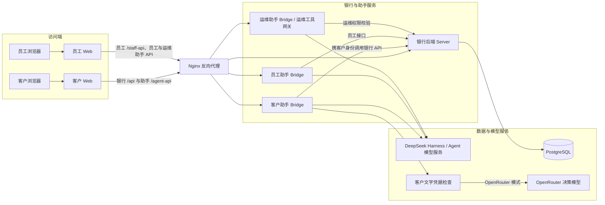
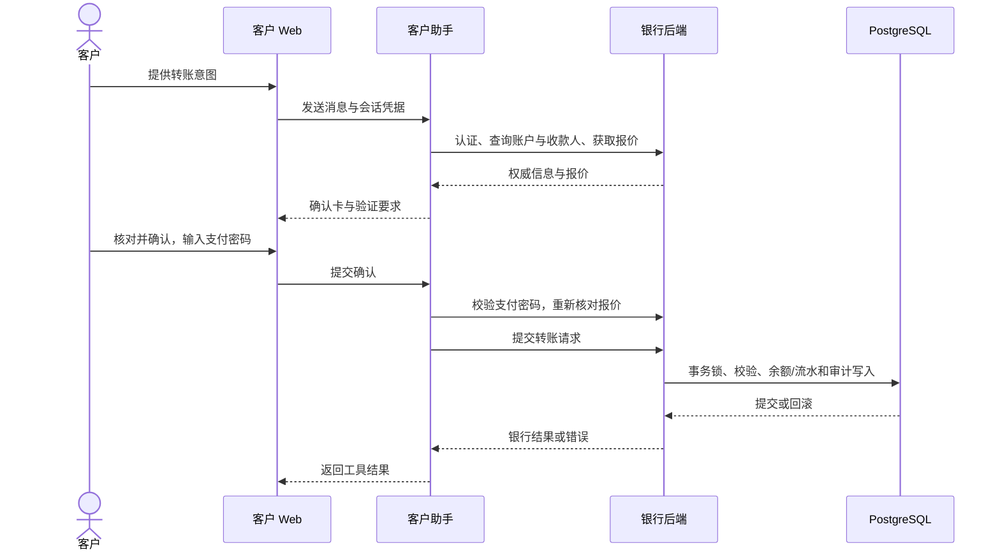

# 招财猫 Bank 技术文档

**版本：** 1.2  
**日期：** 2026 年 11 月 1 日  
**范围：** 客户 Web、员工 Web、银行服务、数据库与智能助手；不含安卓客户端。

# 1 系统架构设计

项目官网：[https://bank.waveflow.men/](https://bank.waveflow.men/)

## 1.1 总体架构

图 1-1 展示系统的主要组件及调用关系。客户与员工分别通过 Web 调用银行服务或对应助手；助手通过银行接口读取业务状态并执行获准操作。Nginx 反向代理将不同请求路由到对应服务。模型服务和凭据检查按运行配置启用，图中仅展示主要调用路径。

**图 1-1 系统主要组件及调用关系。**

## 1.2 组件职责与依赖

银行 HTTP 入口初始化 PostgreSQL、客户认证、安全网关和员工 API，并将路由交给对应处理器。客户请求通过会话确定客户，再激活其业务档案；兼容性业务使用队列，避免并发切换档案时发生串号。

助手桥接不是银行账本。它用用户的银行 Bearer 请求资料与业务接口，对银行响应做错误处理，并检查助手会话归属；银行 API 仍是业务状态和身份校验边界。桥接到银行的 URL 要求 HTTPS 或本机回环 HTTP。

客户、员工与运维 Agent 分别运行于独立服务进程，使用 `luckycat`、`staff` 和 `staff-ops` 配置。三者复用 DeepSeek Harness 与桥接公共代码，分别维护 `customer`、`staff`、`ops` 会话命名空间及附件目录，并共享银行后端。员工 Agent 按员工角色调用业务接口；运维 Agent 使用独立运维工具集及审批网关，对工具执行实施权限校验与审计。

## 1.3 核心运行流程

普通 Web 转账由页面调用报价、收款人解析和提交接口。助手转账多出意图解析及用户确认过程，如图 2-1 所示。两条入口最终都需要依赖银行服务进行支付密码、余额、收款人及业务状态检查；助手回复本身不能作为转账成功证明。

## 1.4 数据架构

`customers` 和 `customer_credentials` 表保存客户及凭据相关记录；`bank_accounts` 使用客户与账户复合键表示归属，以整数分保存余额和可用余额，并通过检查约束限制币种和数值范围。`bank_transactions` 通过复合外键关联账户，记录方向、金额和状态。`ledger_accounts`、`journal_batches`、`journal_entries` 和 `balance_changes` 提供账户、分录批次及余额变化记录；交易查询包含按账户和时间建立的索引。

兼容层将业务档案从数据库加载到内存视图，再在工作单元提交时持久化。服务入口选择按需加载档案的 scoped 投影。该设计使现有业务规则可复用，但需要锁和串行化保证档案切换与写入顺序；本次未实测其吞吐量或扩展性。

## 1.5 部署架构与约束

系统采用单机部署，Nginx 将银行服务、客户助手和员工助手路由至本机不同端口，并提供前端静态资源。HTTPS 入口及 HTTP 跳转由站点配置承担。部署检查期间，相关服务处于运行状态，公网首页及登录路径返回 HTTP 200，匿名助手健康入口返回 HTTP 401。该检查仅覆盖服务可达性，不能替代完整业务和链路安全验证。

# 2 核心业务机制与算法说明

## 2.1 业务问题与一致性方案

本项目重点是业务规则和工程机制，并未在本次范围内发现需要声称为自研的新型算法。转账需要在请求重试、并发和失败时避免错误更新，并确保客户确认的费用、收款信息与提交条件一致。系统将银行请求放入工作单元，结合数据库事务、约束和有条件启用的幂等保护实现这一目标；这些是代码机制，尚未经过本次并发实测。

## 2.2 转账处理

输入包括付款账户、渠道、金额、收款标识、币种和确认条件；输出为银行接口返回的转账结果或错误。主要步骤如下：

1. 报价使用付款账户和渠道计算费用、限额以及可能的换汇信息；本行收款人解析会核对账户和户名，返回掩码信息。
2. 提交时银行服务先验证支付密码；领域逻辑要求金额为大于零的安全整数分，并检查渠道、银行、收款人、币种、限额及可用余额。
3. 服务重新计算手续费和换汇条件，检查提交确认；需要核对的 FPS 登记信息发生变化时返回冲突，要求重新确认。
4. 符合大额在途规则的沙箱交易可先冻结可用余额，窗口内允许撤销或员工处理；到期处理由后端定时器推进。阈值、窗口与处理条件取决于配置和代码。

费用、汇率与预计到账时间是演示业务规则，不是外部银行报价或真实服务承诺。

## 2.3 事务、幂等与错误处理

兼容业务的 `exclusive` 队列开启工作单元；数据库层开始事务，取得 PostgreSQL 事务级 advisory lock，加载视图并设置保存点。成功时写入变更并提交，异常时回滚并恢复缓存。支付密码校验失败这一分支先回滚业务变更，再记录失败及冻结相关状态，避免因失败而提交被拒绝的转账。全局序列化降低切档风险，同时形成并发瓶颈，不能仅根据代码声称具有高并发能力。

对于列入 `IDEMPOTENT_METHODS` 的操作，若请求携带合法 `Idempotency-Key`，服务按客户、键、请求路径和规范化请求内容识别重试；相同请求返回已保存结果，不同请求复用相同键则报冲突。幂等查询、写入和业务变更处于同一事务与锁边界。该键**不是强制的**；未携带时该机制不生效。支付密码被排除在摘要之外。

## 2.4 智能助手工作流

助手基于 DeepSeek Harness 框架运行，并调用可配置模型；这是对外部或配置的预训练模型进行调用及工具编排的实现，不是已证明的模型训练或微调。转账步骤如图 2-1：

**图 2-1 助手发起沙箱转账的主要调用。**助手先取得银行能力与报价，构造确认字段并设置有效期；客户确认后，执行阶段再次验证支付密码并刷新报价，若费用、汇率或收款信息变化则中止并要求重新确认。授权绑定会话、工具调用、参数摘要和所有者，消费后不能重复使用。网络错误、报价过期、权限失效或用户取消都可能阻止提交；最终状态应以银行回执及交易记录为准。

# 3 安全设计

## 3.1 安全目标与信任边界

浏览器、助手、银行服务和数据库处于不同信任位置。用户输入与模型产生的工具参数均不能直接决定账户状态；银行服务对业务请求重新识别用户并执行业务校验。数据库负责约束和事务，反向代理配置负责入口路由；各层措施不能替代端到端安全测试。

## 3.2 认证与授权

客户登录会生成 32 字节随机 Bearer token，服务端仅以 SHA-256 摘要保存会话标识，默认有效期为 12 小时；过期、退出和修改密码后的其他会话撤销均有处理。密码实现使用随机盐和 scrypt，保留旧 SHA-256 格式的验证兼容。旧凭据是否全部迁移未核实。

员工接口存在 `csr`、`supervisor` 和 `ops` 角色检查，部分工单操作还检查处理人。员工权限校验的覆盖范围尚未逐项确认。客户服务通过会话选择档案，但所有对象及全部路由的归属边界尚未逐项审计。

## 3.3 数据保护

数据库加密模块使用 AES-256-GCM 保护调用方传入的相关负载，并校验密钥格式；卡片秘密的写入代码也调用该模块加密。表结构仍包含客户手机号、姓名、交易对手方等明文字段，不能据此声称数据库整体加密。交易自动分类日志可能记录对手方名称，需结合日志策略审查。HTTPS 配置样例存在，但实际传输保护和密钥管理未核验。

## 3.4 业务安全

登录和短信接口设有频率限制；沙箱短信验证码使用随机数、盐和摘要保存，具有过期和尝试次数限制，但沙箱接口会返回演示验证码，不可作为生产短信接入的证据。支付密码失败记录、余额校验、事务与强制幂等共同降低部分重复提交和错误状态风险，覆盖条件以实际调用和代码清单为准。

`NODE_ENV=production` 要求 `BANK_INTEGRATION_MODE=live`；安全网关和银行路由在 live 模式对未接入能力返回不可用。此设计避免直接把沙箱操作当作真实合作银行交易，但不证明合作方接口已经完成或通过监管认证。

## 3.5 Agent 安全

助手工具按查询、写入和需要支付密码的集合区分。确认数据包含用户可核对的字段；执行授权与参数摘要及会话绑定，授权有效期受限且一次消费。助手在提交前重查重要业务数据，银行侧仍验证身份和密码。

**客户文字凭据检查。** 客户 Web 先用 `hasExplicitCredential` 检查包含特定凭据名称及赋值形式的输入，命中时提示使用安全验证窗口。客户端在等待服务端确认时展示占位文本；服务端拒绝时移除占位并尝试恢复草稿。

服务端在客户消息、历史导入、问题卡回答及已绑定客户 IM 文本进入助手前调用检查模块。先用相同规则拦截明确表达，再对剩余非空文字发起决策：OpenRouter 模式默认使用 `respan/span-02`，服务异常、超时或响应格式无效时尝试 `perplexity/pplx-decider-v1.2`；明确判为不安全或不确定时直接拒绝。有效响应的分类与概率须符合格式检查，默认安全概率阈值为 0.5；无可用结果时返回不可用，不将该消息交给业务助手。这个阈值未经过项目数据校准，不能解释为经验证的漏检率或安全保证。

**数据边界。** 本地规则未识别的消息原文会被发送至 OpenRouter 及其上游模型；如果规则漏掉密码，密码可能随之发送。此检查只覆盖文字：纯图片的空文字直接通过，图片本身未受该模块检查；语音音频先发送至语音识别上游，转写文字作为消息提交时才经过检查。客户应通过独立确认卡输入支付密码。这些措施不能证明所有入口、图片、音频或提示注入攻击均已覆盖。

## 3.6 当前限制

短信、外部身份服务与合作机构接口的配置边界，以及模型供应商的数据处理协议和日志留存边界仍待核实。助手并非所有写操作都由相同方式生成幂等键，且银行关键写接口要求携带幂等键；断线和重试需专项测试。明文字段、日志、部署配置、角色权限与备份恢复均需结合实际环境进一步审查。

# 4 项目创新点

## 4.1 技术创新

### 4.1.1 面向银行业务的可控 Agent 执行机制

基于 DeepSeek Harness 构建智能助手，将自然语言意图转化为受约束的工具调用。敏感操作经过参数展示、用户确认与支付密码核验，执行授权绑定会话及参数摘要，并限时、单次使用；提交前重新核对报价，形成从意图理解到业务执行的完整控制链路。

### 4.1.2 规则与多模型协同的凭据防护

在前端与服务端设置文字凭据检查，结合本地规则与 OpenRouter 决策模型识别敏感输入。主模型异常时自动切换备用模型，对不安全、不确定或无有效判定的消息予以拦截，引导用户通过独立验证窗口输入密码。

### 4.1.3 对话操作与账务一致性协同

助手与网页共用银行业务接口，业务结果以银行回执为准。通过数据库事务、锁、约束和关键写操作强制携带的幂等键，将余额、流水及审计记录纳入一致性控制，并在手续费、汇率或收款信息变化时要求重新确认。

## 4.2 功能创新

### 4.2.1 对话式银行业务办理

用户通过自然语言查询账户、交易记录并发起转账。助手补全必要信息、展示业务确认卡片，再根据授权执行操作，将多步骤表单流程组织为连续对话。

### 4.2.2 多模态交互与安全确认结合

支持文字、图片与语音输入，满足不同表达场景；涉及支付密码的操作通过独立确认卡片完成，使日常交流与敏感凭据输入各有明确入口。

### 4.2.3 客户与员工协同处理

为客户与员工提供各自的网页入口和助手，客户可发起业务并查询状态，员工依据角色权限处理工单及相关业务。对在途转账提供撤回与员工介入等处置路径，衔接自助办理与人工服务。

### 4.2.4 预算管理辅助日常理财

将月度分类目标与每日平台支出预算结合，展示实际支出、剩余额度及超支情况，帮助用户规划消费、调整开支。用户可通过助手设置预算；每日预算对命中平台的超额消费进行拦截，并以节制消费积分与额度券提供正向激励，促进持续的财务管理习惯。
